# Especificación de Servicios Backend - Kamadeva System

Este documento recopila la lista completa de **servicios, funciones, endpoints y campos** requeridos en el backend de acuerdo con los modelos, flujos y pantallas de la aplicación cliente en Flutter.

---

## 1. Resumen Arquitectónico

- **Base URL local:** `http://localhost:3000/api`
- **Autenticación:** Bearer Token JWT en el encabezado `Authorization: Bearer <token>`.
- **Formato de Comunicación:** JSON (`Content-Type: application/json`).
- **Formato de Fechas:** ISO-8601 UTC (`YYYY-MM-DDTHH:mm:ss.sssZ`).
- **Estrategia Transaccional:**
  - Operaciones de venta (`/checkout/sales`) y ajuste de inventario (`/inventory/products/:id/adjust-stock`) deben utilizar transacciones con aislamiento o bloqueo pesimista (`SELECT FOR UPDATE`) para evitar stock negativo.
  - Soportar clave de idempotencia (`idempotencyKey` UUID v4) en ventas para evitar cobros duplicados por pérdidas de conexión.
  - El corte de caja es inmutable una vez emitido; asocia los gastos del turno mediante `cashClosureId`.

---

## 2. Mapa Rápido de Microservicios y Módulos

```mermaid
graph TD
    A[API Gateway / Router] --> B[Auth & RBAC Service /api/auth]
    A --> C[Business Config Service /api/core-config/business]
    A --> D[Categories Service /api/core-config/categories]
    A --> E[Clients Service /api/core-config/clients]
    A --> F[Providers Service /api/core-config/providers]
    A --> G[Products & Inventory Service /api/inventory/products]
    A --> H[Kardex Service /api/inventory/kardex]
    A --> I[Sales & Checkout Service /api/checkout/sales]
    A --> J[Quotes Service /api/checkout/quotes]
    A --> K[Expenses Service /api/finance/expenses]
    A --> L[Cash Closure Service /api/finance/cash-closures]
    A --> M[Analytics & Dashboard Service /api/analytics]
```



---

## 3. Catálogo Detallado por Servicio

### 1. Autenticación y Control de Acceso (`Auth & RBAC Service`)
- **Ruta Base:** `/api/auth`
- **Modelos Cliente:** [`UserModel`](file:///Users/mike/Documents/kamadeva_system/lib/features/auth/data/models/user_model.dart), [`UserEntity`](file:///Users/mike/Documents/kamadeva_system/lib/features/auth/domain/entities/user_entity.dart)

#### Campos de la Entidad `User`
| Campo | Tipo | Obligatorio | Descripción |
| :--- | :--- | :---: | :--- |
| `id` | `String (UUID)` | Sí | Identificador único |
| `nombre` | `String` | Sí | Nombre completo del usuario |
| `email` | `String` | No | Correo electrónico de acceso |
| `telefono` | `String` | No | Número de teléfono de contacto |
| `password` | `String` | Sí | Contraseña (cifrada con Argon2 o Bcrypt en BD) |
| `rol` | `String` | Sí | Rol de usuario (`'admin'` o `'seller'`) |
| `seccionesPermitidas` | `List<String>` | Sí | Slugs de pantallas permitidas (ej. `["home", "products", "sales_history", "cash_closure"]`) |
| `creadoPorAdminId` | `String (UUID)` | No | ID del administrador que dio de alta la cuenta |
| `activo` | `Boolean` | Sí | Estado de la cuenta (soft delete) |

#### Funciones y Endpoints
1. **`POST /api/auth/login`**
   - **Body:** `{ "email": string, "password": string }`
   - **Respuesta (200):**
     ```json
     {
       "accessToken": "eyJhbGciOi...",
       "refreshToken": "eyJhbGciOi...",
       "user": {
         "id": "uuid",
         "nombre": "Carlos López",
         "email": "carlos@kamadeva.com",
         "telefono": "5551234567",
         "rol": "seller",
         "seccionesPermitidas": ["home", "products", "sales_history", "cash_closure"]
       }
     }
     ```
2. **`POST /api/auth/register`**
   - **Body:** `{ "nombre": string, "email"?: string, "telefono"?: string, "password": string, "rol": "admin"|"seller", "seccionesPermitidas": string[], "creadoPorAdminId"?: string }`
   - **Respuesta (201):** Usuario creado (sin incluir hash de password).
3. **`GET /api/auth/has-admin`**
   - **Respuesta (200):** `{ "hasAdmin": boolean }`
4. **`GET /api/auth/:id`**
   - **Respuesta (200):** Detalle del usuario solicitado.
5. **`PUT /api/auth/:id`**
   - **Body:** `{ "nombre"?: string, "email"?: string, "telefono"?: string, "password"?: string, "rol"?: string, "seccionesPermitidas"?: string[] }`
   - **Respuesta (200):** Usuario modificado.
6. **`DELETE /api/auth/:id`**
   - **Respuesta (200/204):** Desactivación lógica del usuario.

---

### 2. Configuración del Negocio (`Business Config Service`)
- **Ruta Base:** `/api/core-config/business`
- **Modelos Cliente:** [`BusinessConfigModel`](file:///Users/mike/Documents/kamadeva_system/lib/features/auth/data/models/business_config_model.dart)
- **Propósito:** Alimenta los datos fiscales, comerciales y de pie de ticket impreso.

#### Campos de la Entidad `BusinessConfig`
| Campo | Tipo | Obligatorio | Descripción |
| :--- | :--- | :---: | :--- |
| `nombre` | `String` | Sí | Nombre o razón comercial del establecimiento |
| `direccion` | `String` | Sí | Calle y número exterior/interior |
| `colonia` | `String` | Sí | Colonia o asentamiento |
| `municipio` | `String` | Sí | Municipio / Alcaldía |
| `estado` | `String` | Sí | Estado o Entidad Federativa |
| `telefono` | `String` | Sí | Teléfono de contacto impreso |
| `rfc` | `String` | Sí | Clave de Registro Federal de Contribuyentes |
| `mensajePie` | `String` | Sí | Leyenda de cortesía y redes sociales |

#### Funciones y Endpoints
1. **`GET /api/core-config/business`**
   - **Respuesta (200):** Datos vigentes de la empresa.
2. **`PUT /api/core-config/business`**
   - **Permiso:** Rol `admin`.
   - **Body:** Objeto completo con los 8 campos de configuración.

---

### 3. Catálogo de Categorías (`Categories Service`)
- **Ruta Base:** `/api/core-config/categories`
- **Modelos Cliente:** [`CategoryModel`](file:///Users/mike/Documents/kamadeva_system/lib/features/categories/data/models/category_model.dart)

#### Campos de la Entidad `Category`
| Campo | Tipo | Obligatorio | Descripción |
| :--- | :--- | :---: | :--- |
| `id` | `String (UUID)` | Sí | Identificador de categoría |
| `nombre` | `String` | Sí | Nombre (ej. "Playeras", "Pantalones") |
| `descripcion` | `String` | Sí | Descripción o notas |
| `activo` | `Boolean` | Sí | Estado de visibilidad |

#### Funciones y Endpoints
1. **`GET /api/core-config/categories`** -> Retorna lista `Category[]`.
2. **`POST /api/core-config/categories`** -> `{ "nombre": string, "descripcion": string }`
3. **`PUT /api/core-config/categories/:id`** -> `{ "nombre"?: string, "descripcion"?: string }`
4. **`DELETE /api/core-config/categories/:id`** -> Elimina o desactiva la categoría.

---

### 4. Directorio de Clientes (`Clients Service`)
- **Ruta Base:** `/api/core-config/clients`
- **Modelos Cliente:** [`ClientModel`](file:///Users/mike/Documents/kamadeva_system/lib/features/clients/data/models/client_model.dart)

#### Campos de la Entidad `Client`
| Campo | Tipo | Obligatorio | Descripción |
| :--- | :--- | :---: | :--- |
| `id` | `String (UUID)` | Sí | Identificador único |
| `nombre` | `String` | Sí | Nombre o Razón Social |
| `telefono` | `String` | No | Teléfono de contacto |
| `email` | `String` | No | Correo electrónico |
| `direccion` | `String` | No | Dirección física de entrega o fiscal |
| `rfc` | `String` | No | RFC para facturación |
| `notas` | `String` | No | Comentarios o historial de crédito/preferencias |

#### Funciones y Endpoints
1. **`GET /api/core-config/clients`** -> Query opcional: `?search=texto`.
2. **`POST /api/core-config/clients`** -> `{ "nombre": string, "telefono"?: string, "email"?: string, "direccion"?: string, "rfc"?: string, "notas"?: string }`
3. **`PUT /api/core-config/clients/:id`** -> Modifica datos del cliente.
4. **`DELETE /api/core-config/clients/:id`** -> Elimina el registro del cliente.

---

### 5. Directorio de Proveedores (`Providers Service`)
- **Ruta Base:** `/api/core-config/providers`
- **Modelos Cliente:** [`ProviderModel`](file:///Users/mike/Documents/kamadeva_system/lib/features/providers/data/models/provider_model.dart)

#### Campos de la Entidad `Provider`
| Campo | Tipo | Obligatorio | Descripción |
| :--- | :--- | :---: | :--- |
| `id` | `String (UUID)` | Sí | Identificador único |
| `nombre` | `String` | Sí | Razón social de la empresa proveedora |
| `telefono` | `String` | No | Teléfono de ventas |
| `email` | `String` | No | Correo de pedidos |
| `contacto` | `String` | No | Nombre del agente o ejecutivo comercial |
| `direccion` | `String` | No | Dirección o bodega de despacho |

#### Funciones y Endpoints
1. **`GET /api/core-config/providers`** -> Listado de proveedores registrados.
2. **`POST /api/core-config/providers`** -> `{ "nombre": string, "telefono"?: string, "email"?: string, "contacto"?: string, "direccion"?: string }`
3. **`PUT /api/core-config/providers/:id`** -> Actualización de datos.
4. **`DELETE /api/core-config/providers/:id`** -> Eliminación del proveedor.

---

### 6. Productos e Inventario (`Products Service`)
- **Ruta Base:** `/api/inventory/products`
- **Modelos Cliente:** [`ProductModel`](file:///Users/mike/Documents/kamadeva_system/lib/features/products/data/models/product_model.dart)

#### Campos de la Entidad `Product`
| Campo | Tipo | Obligatorio | Descripción |
| :--- | :--- | :---: | :--- |
| `id` | `String (UUID)` | Sí | Identificador único del producto |
| `articulo` | `String` | Sí | Nombre comercial del artículo |
| `descripcion` | `String` | Sí | Detalle o especificación técnica |
| `codigoBarras` | `String` | Sí | Código de barras legible por pistola / escáner |
| `stock` | `Integer` | Sí | Existencia física disponible (>= 0) |
| `categoria` | `String` | Sí | Categoría a la que pertenece |
| `marca` | `String` | Sí | Marca o fabricante del artículo |
| `precioCompra` | `Double` | Sí | Costo de adquisición unitario (>= 0) |
| `precioVenta` | `Double` | Sí | Precio de venta al público en mostrador (>= 0) |
| `tallas` | `List<String>` | No | Arreglo de tallas admitidas (ej. `["S", "M", "L"]` o `["28", "30"]`) |
| `imageUrl` | `String` | No | URL de fotografía del producto |
| `activo` | `Boolean` | Sí | Soft-delete del producto |

#### Funciones y Endpoints
1. **`GET /api/inventory/products`**
   - **Query Parameters:** `?query=string&categoria=string&lowStock=true`
   - Retorna lista filtrada de `Product[]`.
2. **`POST /api/inventory/products`**
   - **Body:** Objeto `Product` sin `id`.
3. **`PUT /api/inventory/products/:id`**
   - **Body:** Campos actualizados del producto.
4. **`DELETE /api/inventory/products/:id`**
   - **Lógica:** Desactiva o elimina el producto.
5. **`POST /api/inventory/products/bulk`**
   - **Body:** `{ "productos": [ { ...campos de producto... } ] }`
   - **Lógica:** Inserción o actualización masiva desde importaciones Excel.
6. **`POST /api/inventory/products/:id/adjust-stock`**
   - **Body:**
     ```json
     {
       "tipo": "ajuste",
       "cantidad": 5,
       "motivo": "Ajuste por conteo físico en tienda",
       "usuarioNombre": "Carlos López"
     }
     ```
   - **Lógica:** Modifica el stock del producto de forma atómica y crea un registro correspondiente en el Kardex.

---

### 7. Movimientos de Stock y Auditoría (`Kardex Service`)
- **Ruta Base:** `/api/inventory/kardex`
- **Modelos Cliente:** [`StockMovementModel`](file:///Users/mike/Documents/kamadeva_system/lib/features/products/data/models/stock_movement_model.dart)

#### Campos de la Entidad `StockMovement`
| Campo | Tipo | Obligatorio | Descripción |
| :--- | :--- | :---: | :--- |
| `id` | `String (UUID)` | Sí | Identificador del movimiento |
| `productId` | `String (UUID)` | Sí | Producto afectado |
| `productoNombre` | `String` | Sí | Snapshot del nombre del producto |
| `tipo` | `String` | Sí | `'entrada' \| 'salida' \| 'ajuste' \| 'venta'` |
| `cantidad` | `Integer` | Sí | Número de unidades involucradas |
| `stockPrevio` | `Integer` | Sí | Existencia antes de la operación |
| `stockNuevo` | `Integer` | Sí | Existencia resultante tras la operación |
| `motivo` | `String` | Sí | Razón del movimiento o folio de venta asociado |
| `fecha` | `DateTime` | Sí | Marca temporal de la operación |
| `usuarioNombre` | `String` | Sí | Usuario que autorizó o realizó el movimiento |

#### Funciones y Endpoints
1. **`GET /api/inventory/kardex`**
   - **Query Parameters:** `?productId=uuid&tipo=entrada&startDate=...&endDate=...`
   - Retorna lista de `StockMovement[]`.
2. **`POST /api/inventory/kardex`**
   - Registra una entrada manual por compra de mercancía a proveedor.

---

### 8. Punto de Venta y Transacciones (`Sales & Checkout Service`)
- **Ruta Base:** `/api/checkout/sales`
- **Modelos Cliente:** [`SaleModel`](file:///Users/mike/Documents/kamadeva_system/lib/features/sales/data/models/sale_model.dart), [`SaleProductModel`](file:///Users/mike/Documents/kamadeva_system/lib/features/sales/data/models/sale_model.dart)

#### Campos de la Entidad `Sale` (Venta)
| Campo | Tipo | Obligatorio | Descripción |
| :--- | :--- | :---: | :--- |
| `id` | `String (UUID)` | Sí | Identificador único de la venta |
| `folio` | `Integer` | Sí | Folio secuencial correlativo impreso en ticket |
| `fecha` | `DateTime` | Sí | Fecha y hora exacta de cobro |
| `metodoPago` | `String` | Sí | `'CASH' \| 'CARD' \| 'TRANSFER'` |
| `total` | `Double` | Sí | Importe monetario total cobrado (>= 0) |
| `vendedorId` | `String (UUID)` | Sí | Identificador del vendedor en turno |
| `vendedorNombre` | `String` | Sí | Nombre del vendedor para el ticket |
| `clienteId` | `String (UUID)` | No | Cliente asignado a la venta |
| `idempotencyKey` | `String (UUID)` | Sí | Llave anti-duplicados por caídas de red |
| `status` | `String` | Sí | `'COMPLETED' \| 'CANCELLED'` |
| `productos` | `List<SaleProduct>` | Sí | Artículos vendidos en la transacción |

#### Campos de cada elemento de `SaleProduct`
- `productId` (`String`): ID del producto.
- `articulo` (`String`): Nombre del producto.
- `cantidad` (`Integer`): Cantidad de piezas vendidas (> 0).
- `precioVenta` (`Double`): Precio unitario al momento de la venta.
- `talla` (`String`, opcional): Talla seleccionada de la prenda.

#### Funciones y Endpoints
1. **`POST /api/checkout/sales`** (Checkout Principal)
   - **Body:**
     ```json
     {
       "idempotencyKey": "e3a89045-8ce6-4a16-9289-536dc4c85244",
       "metodoPago": "CASH",
       "clienteId": "uuid-cliente-opcional",
       "productos": [
         {
           "productId": "uuid-producto-1",
           "cantidad": 2,
           "talla": "M"
         }
       ]
     }
     ```
   - **Lógica Backend:** Inicia transacción DB -> Bloquea filas de stock (`SELECT FOR UPDATE`) -> Valida disponibilidad de inventario -> Descuenta existencias -> Genera entradas en Kardex (`tipo: 'venta'`) -> Calcula total -> Asigna siguiente `folio` autoincremental -> Registra venta y detalle -> Commit.
   - **Respuesta (201):**
     ```json
     {
       "id": "uuid-venta",
       "folio": 1045,
       "total": 598.00,
       "fecha": "2026-10-29T07:15:00Z"
     }
     ```
2. **`GET /api/checkout/sales`**
   - **Query Parameters:** `?startDate=2026-10-01&endDate=2026-10-29&vendedorId=...`
   - Retorna histórico de ventas con su desglose de productos.
3. **`GET /api/checkout/sales/:id`**
   - Retorna una venta en particular con detalle completo para reimpresión de ticket.
4. **`POST /api/checkout/sales/:id/cancel`**
   - Anula la venta, devuelve las unidades vendidas al stock de cada producto y crea un movimiento de tipo `'entrada'`/`'ajuste'` en el Kardex.

---

### 9. Cotizaciones y Presupuestos (`Quotes Service`)
- **Ruta Base:** `/api/checkout/quotes`
- **Modelos Cliente:** [`QuoteModel`](file:///Users/mike/Documents/kamadeva_system/lib/features/quotes/data/models/quote_model.dart)

#### Campos de la Entidad `Quote`
| Campo | Tipo | Obligatorio | Descripción |
| :--- | :--- | :---: | :--- |
| `id` | `String (UUID)` | Sí | Identificador de cotización |
| `fecha` | `DateTime` | Sí | Fecha de emisión |
| `fechaCaducidad` | `DateTime` | Sí | Fecha de vencimiento de precios |
| `clienteNombre` | `String` | Sí | Nombre del cliente |
| `clienteId` | `String (UUID)` | No | ID del cliente registrado |
| `total` | `Double` | Sí | Importe presupuestado |
| `status` | `String` | Sí | `'PENDING' \| 'EXPIRED' \| 'CONVERTED_TO_SALE'` |
| `productos` | `List<SaleProduct>` | Sí | Artículos cotizados |

#### Funciones y Endpoints
1. **`GET /api/checkout/quotes`** -> Lista cotizaciones registradas.
2. **`POST /api/checkout/quotes`** -> Crea cotización sin descontar stock.
3. **`DELETE /api/checkout/quotes/:id`** -> Elimina la cotización.
4. **`POST /api/checkout/quotes/:id/convert-to-sale`** -> Convierte la cotización en venta formal ejecutando el descuento de inventario.

---

### 10. Gastos Operativos (`Expenses Service`)
- **Ruta Base:** `/api/finance/expenses`
- **Modelos Cliente:** [`ExpenseModel`](file:///Users/mike/Documents/kamadeva_system/lib/features/expenses/data/models/expense_model.dart)

#### Campos de la Entidad `Expense`
| Campo | Tipo | Obligatorio | Descripción |
| :--- | :--- | :---: | :--- |
| `id` | `String (UUID)` | Sí | Identificador del gasto |
| `fecha` | `DateTime` | Sí | Fecha y hora del gasto |
| `concepto` | `String` | Sí | Motivo (ej. "Compra de bolsas de entrega") |
| `monto` | `Double` | Sí | Importe gastado (> 0) |
| `descontarDeCaja` | `Boolean` | Sí | Si es `true`, reduce el dinero en efectivo esperado en caja |
| `categoria` | `String` | Sí | Categoría del gasto (ej. "Servicios", "Insumos") |
| `vendedorId` | `String (UUID)` | Sí | Vendedor que registró el egreso |
| `vendedorNombre` | `String` | Sí | Nombre del vendedor |
| `cashClosureId` | `String (UUID)` | No | ID del corte de caja que absorbió este gasto |

#### Funciones y Endpoints
1. **`GET /api/finance/expenses/current-shift`**
   - Retorna únicamente los gastos donde `cashClosureId IS NULL` (turno activo).
2. **`GET /api/finance/expenses`**
   - Query: `?startDate=...&endDate=...` (Histórico global).
3. **`POST /api/finance/expenses`**
   - **Body:** `{ "fecha": string, "concepto": string, "monto": number, "descontarDeCaja": boolean, "categoria": string, "vendedorId": string, "vendedorNombre": string }`
4. **`DELETE /api/finance/expenses/:id`**
   - Elimina el gasto (solo permitido si aún no ha sido liquidado en un corte).

---

### 11. Arqueo y Cortes de Caja (`Cash Closure Service`)
- **Ruta Base:** `/api/finance/cash-closures`
- **Modelos Cliente:** [`CashClosureModel`](file:///Users/mike/Documents/kamadeva_system/lib/features/cash_closure/data/models/cash_closure_model.dart)

#### Invariante Financiera de Cuadre
$$\text{Esperado en Caja} = \text{Caja Inicial} + \text{Ventas en Efectivo} - \text{Gastos Descontados de Caja}$$
$$\text{Diferencia} = \text{Total Calculado (Conteo Físico)} - \text{Esperado en Caja}$$

#### Campos de la Entidad `CashClosure`
| Campo | Tipo | Obligatorio | Descripción |
| :--- | :--- | :---: | :--- |
| `id` | `String (UUID)` | Sí | Identificador único del corte |
| `fecha` | `DateTime` | Sí | Fecha y hora de finalización del turno |
| `vendedorId` | `String (UUID)` | Sí | Cajero responsable del turno |
| `vendedorNombre` | `String` | Sí | Nombre del cajero |
| `cajaInicial` | `Double` | Sí | Fondo de caja inicial (>= 0) |
| `denominations` | `Map<String, int>` | Sí | Conteo de billetes y monedas (ver detalle abajo) |
| `totalCalculado` | `Double` | Sí | Sumatoria del efectivo contado físicamente |
| `totalVentasEfectivo`| `Double` | Sí | Ventas en efectivo durante el turno |
| `totalGastosDescontados`| `Double`| Sí | Gastos con `descontarDeCaja = true` del turno |
| `esperadoEnCaja` | `Double` | Sí | Monto teórico que debió existir en caja |
| `diferencia` | `Double` | Sí | `totalCalculado - esperadoEnCaja` (faltante o sobrante) |
| `observaciones` | `String` | No | Notas explicativas sobre descuadres |
| `status` | `String` | Sí | `'CLOSED' \| 'AUDITED'` |

#### Estructura de `denominations` (JSON)
```json
{
  "1000": 2,
  "500": 4,
  "200": 5,
  "100": 10,
  "50": 8,
  "20": 15,
  "10": 20,
  "5": 30,
  "2": 25,
  "1": 40,
  "0.5": 10
}
```

#### Funciones y Endpoints
1. **`GET /api/finance/cash-closures/current-summary`**
   - Retorna las ventas en efectivo del turno activo y los gastos descontados para prellenar la vista de arqueo en la app.
2. **`POST /api/finance/cash-closures`**
   - Recibe el conteo físico, calcula la diferencia, sella el corte y asigna el `cashClosureId` a todos los gastos del turno.
3. **`GET /api/finance/cash-closures`**
   - Retorna el histórico de cortes ordenado por fecha de forma descendente.
4. **`GET /api/finance/cash-closures/:id`**
   - Retorna el detalle y desglose de denominaciones de un corte en particular.

---

### 12. Métricas y KPIs (`Dashboard & Analytics Service`)
- **Ruta Base:** `/api/analytics`
- **Pantalla Cliente:** [`DashboardPage`](file:///Users/mike/Documents/kamadeva_system/lib/features/dashboard/presentation/pages/dashboard_page.dart)

#### Funciones y Endpoints
1. **`GET /api/analytics/dashboard/summary`**
   - **Respuesta (200):**
     ```json
     {
       "ventasHoy": {
         "montoTotal": 14250.00,
         "ticketsCount": 38,
         "efectivoTotal": 9800.00,
         "tarjetaTotal": 4450.00
       },
       "inventario": {
         "totalProductos": 342,
         "productosStockBajo": 6
       },
       "gastosHoy": {
         "total": 650.00,
         "descontadosDeCaja": 350.00
       },
       "utilidadEstimadaHoy": 5280.00
     }
     ```
2. **`GET /api/analytics/dashboard/top-products`**
   - Retorna el Top 5/10 de productos con más ventas en el periodo actual.
3. **`GET /api/analytics/dashboard/sales-history-chart`**
   - Retorna montos agrupados por día de la semana para graficar curvas de ventas.

---

## 4. Códigos de Respuesta HTTP Estandarizados

| Código | Descripción | Cuándo se utiliza en Kamadeva |
| :---: | :--- | :--- |
| **`200 OK`** | Operación exitosa | Búsquedas, consultas y actualizaciones regulares |
| **`201 Created`** | Recurso creado exitosamente | Creación de producto, venta completada, corte liquidado |
| **`400 Bad Request`** | Parámetros o DTO inválidos | Falta de campos obligatorios, cantidades menores a 0 |
| **`401 Unauthorized`** | No autenticado | Token ausente, caducado o firma no válida |
| **`403 Forbidden`** | Sin permisos | Un vendedor intentando modificar configuración del negocio o ver vendedores |
| **`404 Not Found`** | Recurso no encontrado | Producto o venta inexistente |
| **`409 Conflict`** | Conflicto de negocio / unicidad | Código de barras duplicado, folio repetido, stock insuficiente |
| **`500 Internal Error`** | Error no controlado | Error de base de datos o excepción no capturada |
