# Especificación Técnica de Servicios, Entidades y Campos: Kamadeva System Backend

**Versión:** 2.0.0  
**Fecha:** Noviembre 2026  
**Sistema:** Kamadeva System (Punto de Venta e Inventario Retail Multiplataforma)  
**Stack de Referencia:** NestJS 12 (TypeScript, Node.js ESM), PostgreSQL 15+, Prisma ORM 7 (`@prisma/adapter-pg`), OpenAPI 3.0 (Swagger en `/api/docs`), JWT (Access / Refresh Tokens hasheados con rotación atómica)  
**URL Base local:** `http://localhost:3000/api`  
**Documentación Swagger interactiva:** `http://localhost:3000/api/docs`

---

## 1. Visión General y Arquitectura de Datos

El backend de **Kamadeva System** implementa una arquitectura modular limpia orientada a dominio sobre NestJS. Para asegurar máxima compatibilidad y consistencia con las aplicaciones cliente (Flutter / Web / Móvil), expone un **contrato público totalmente en español**.

### 1.1 Capa de Adaptación de Contrato en Español
Mediante el middleware `spanishApiMiddleware`, el interceptor `SpanishApiResponseInterceptor` y el transformador de esquemas Swagger `translateOpenApiSchemas` (`src/common/validation/spanish-api-contract.ts`):
1. **Traducción Bidireccional Transparente:** Las peticiones entrantes traducen queries, parámetros de ruta y payloads JSON desde las claves públicas en español a los nombres internos del dominio y modelos de Prisma.
2. **Serialización Estandarizada:** Todas las respuestas HTTP retornan las entidades con claves unificadas en español (`nombre`, `correo`, `contrasena`, `tokenAcceso`, `tokenRenovacion`, `existencias`, `existenciaMinima`, `precioVenta`, `precioCompra`, `urlImagen`, `fechaCreacion`, `fechaActualizacion`, etc.).
3. **Esquema OpenAPI Fiel:** Los esquemas generados en `/api/docs` exponen exclusivamente los campos públicos en español.

### 1.2 Principios de Integridad, Transaccionalidad y Concurrencia
1. **Inventario Derivado (Event Sourcing / Kardex):**
   - El inventario físico de una tienda retail no debe depender de actualizaciones planas (`UPDATE products SET stock = ...`).
   - Las existencias (`existencias`) se derivan matemáticamente de la sumatoria auditada de movimientos en `InventoryMovement`:
     $$\text{existencias} = \sum \text{quantityChange} \quad (\text{PURCHASE\_IN, SALE\_OUT, RETURN\_IN, ADJUSTMENT\_IN, ADJUSTMENT\_OUT})$$
   - Toda alteración de stock ejecuta transacciones serializables en PostgreSQL con bloqueo pesimista (`SELECT FOR UPDATE`).
2. **Idempotencia Transaccional en Cobro (`/api/ventas`):**
   - El endpoint de venta exige la cabecera obligatoria `Idempotency-Key` (UUID v4).
   - Si una petición de cobro se reintenta por desconexión o fallo de red, el sistema intercepta la clave persistida en `IdempotencyKey`, evitando folios duplicados, dobles cobros y deducciones indebidas de existencias.
   - Las respuestas reenviadas por idempotencia incorporan la cabecera HTTP `Idempotent-Replayed: true`.
3. **Cortes de Caja en Cadena e Inmutabilidad (`/api/cortes-caja`):**
   - No se permiten turnos solapados ni ediciones retroactivas.
   - Los cortes implementan una cadena estricta (`previousClosureId @unique`).
   - El fondo dejado en caja (`fondoDejado`) al sellar un turno se convierte automáticamente en el fondo inicial (`fondoInicial`) del siguiente arqueo.
4. **Control de Acceso Basado en Roles (RBAC):**
   - **`ADMIN`:** Control total del sistema: catálogos, personal, auditoría, configuración fiscal, compras a proveedores, costos y utilidad estimada del tablero.
   - **`VENDEDOR`:** Operaciones de mostrador: punto de venta, cotizaciones, consulta de productos, registro de gastos de turno y arqueo de corte de caja propio. No tiene visibilidad del margen ni costo de mercancía.

---

## 2. Diagrama Entidad-Relación (ERD)

```mermaid
erDiagram
    User ||--o{ UserRole : "tiene"
    Role ||--o{ UserRole : "asignado_a"
    User ||--o{ RefreshToken : "sesiones"
    User ||--o{ Sale : "crea"
    User ||--o{ Sale : "cancela"
    User ||--o{ Quote : "crea"
    User ||--o{ Purchase : "registra"
    User ||--o{ SupplierOrder : "ordena"
    User ||--o{ Expense : "registra"
    User ||--o{ CashClosure : "cierra"
    User ||--o{ InventoryMovement : "autoriza"

    Customer ||--o{ Sale : "asociado_a"
    Customer ||--o{ Quote : "solicita"

    Provider ||--o{ Purchase : "surte"
    Provider ||--o{ SupplierOrder : "recibe_pedido"

    Category ||--o{ Product : "clasifica"
    Product ||--o{ ProductSize : "disponible_en"
    Size ||--o{ ProductSize : "aplica_a"

    Product ||--o{ SaleItem : "vendido_en"
    Product ||--o{ QuoteItem : "cotizado_en"
    Product ||--o{ PurchaseItem : "comprado_en"
    Product ||--o{ SupplierOrderItem : "pedido_en"
    Product ||--o{ InventoryMovement : "movimiento_kardex"

    Size ||--o{ SaleItem : "talla_vendida"
    Size ||--o{ QuoteItem : "talla_cotizada"

    Sale ||--|{ SaleItem : "contiene"
    Sale ||--|{ Payment : "liquidada_con"
    Quote ||--|{ QuoteItem : "contiene"
    Quote ||--o| Sale : "convertida_en"

    SupplierOrder ||--|{ SupplierOrderItem : "solicita"
    SupplierOrder ||--o{ Purchase : "recepciones"
    Purchase ||--|{ PurchaseItem : "detalla"
    SupplierOrderItem ||--o{ PurchaseItem : "recibido_en"

    ExpenseCategory ||--o{ Expense : "clasifica"
    CashClosure ||--o{ CashClosureAdjustment : "desglosa_ajustes"
    CashClosure ||--o{ Payment : "arquea_cobros"
    CashClosure ||--o{ Payment : "arquea_reembolsos"
    CashClosure ||--o{ Expense : "absorbe_gastos"
    CashClosure ||--o| CashClosure : "cadena_turno_anterior"

    BusinessConfig {
        string key PK
        string name
        string address
        string neighborhood
        string municipality
        string state
        string phone
        string taxId
        string ticketFooter
    }

    User {
        uuid id PK
        string name
        string email UK
        string passwordHash
        boolean isActive
    }

    Role {
        uuid id PK
        string name UK
        string description
        boolean isActive
    }

    RefreshToken {
        uuid id PK
        string tokenHash
        uuid userId FK
        timestamp expiresAt
        timestamp revokedAt
    }

    Category {
        uuid id PK
        string name
        string slug UK
        string description
        boolean isActive
    }

    Size {
        uuid id PK
        string name UK
        int sortOrder
        boolean isActive
    }

    Product {
        uuid id PK
        string barcode UK
        string name
        string description
        string brand
        string imageUrl
        decimal price
        decimal cost
        decimal minStock
        boolean isActive
        uuid categoryId FK
    }

    Customer {
        uuid id PK
        string name
        string phone
        string email
        boolean isActive
        boolean isDefault
    }

    Provider {
        uuid id PK
        string name UK
        string phone
        string email
        string contactName
        string address
        boolean isActive
    }

    InventoryMovement {
        uuid id PK
        uuid productId FK
        string type
        decimal quantityChange
        decimal unitCost
        string referenceType
        string referenceId
        uuid createdById FK
        string notes
    }

    Purchase {
        uuid id PK
        uuid providerId FK
        timestamp receivedAt
        string supplierFolio
        string notes
        decimal total
        uuid supplierOrderId FK
        uuid createdById FK
    }

    PurchaseItem {
        uuid id PK
        uuid purchaseId FK
        uuid productId FK
        int position
        string productName
        string barcode
        decimal quantity
        decimal unitCost
        decimal lineSubtotal
    }

    SupplierOrder {
        uuid id PK
        uuid providerId FK
        timestamp orderedAt
        timestamp expectedAt
        string supplierFolio
        string notes
        decimal total
        string status
        uuid createdById FK
    }

    SupplierOrderItem {
        uuid id PK
        uuid orderId FK
        uuid productId FK
        int position
        string productName
        string barcode
        decimal quantity
        decimal receivedQuantity
        decimal unitCost
        decimal lineSubtotal
    }

    Sale {
        uuid id PK
        string folio UK
        string status
        uuid customerId FK
        uuid quoteId FK
        decimal subtotal
        decimal discount
        decimal tax
        decimal total
        uuid createdById FK
        string notes
        timestamp cancelledAt
        uuid cancelledById FK
        string cancelReason
    }

    SaleItem {
        uuid id PK
        uuid saleId FK
        uuid productId FK
        uuid sizeId FK
        decimal quantity
        decimal unitPrice
        decimal discount
        decimal tax
        decimal total
        decimal unitCost
    }

    Payment {
        uuid id PK
        uuid saleId FK
        decimal amount
        string method
        string status
        uuid createdById FK
        uuid cashClosureId FK
        uuid refundClosureId FK
        timestamp paidAt
    }

    Quote {
        uuid id PK
        string folio UK
        string status
        uuid customerId FK
        decimal subtotal
        decimal discount
        decimal tax
        decimal total
        string notes
        timestamp expiresAt
        uuid createdById FK
    }

    QuoteItem {
        uuid id PK
        uuid quoteId FK
        uuid productId FK
        uuid sizeId FK
        decimal quantity
        decimal unitPrice
        decimal discount
        decimal tax
        decimal total
    }

    ExpenseCategory {
        uuid id PK
        string name UK
        boolean isActive
    }

    Expense {
        uuid id PK
        string concept
        decimal amount
        boolean deductFromCash
        string notes
        timestamp spentAt
        uuid categoryId FK
        uuid createdById FK
        uuid cashClosureId FK
    }

    CashClosure {
        uuid id PK
        uuid previousClosureId UK
        timestamp periodStart
        timestamp closedAt
        uuid closedById FK
        decimal openingFloat
        int salesCount
        decimal cashSales
        decimal cardSales
        decimal transferSales
        decimal otherSales
        decimal cashRefunds
        decimal totalRefunds
        int expensesCount
        decimal cashExpenses
        decimal totalExpenses
        decimal adjustmentsIn
        decimal adjustmentsOut
        decimal expectedCash
        decimal countedCash
        decimal difference
        decimal floatLeft
        jsonb denominations
        string notes
    }

    CashClosureAdjustment {
        uuid id PK
        uuid cashClosureId FK
        int position
        string type
        decimal amount
        string description
    }
```



---

## 3. Catálogo Detallado de Servicios, Endpoints y Campos

---

### MÓDULO 1: Autenticación (`/api/autenticacion`)
- **Base Endpoint:** `/api/autenticacion`
- **Controlador:** [`AuthController`](file:///Users/mike/Documents/kamadeva-system-backend/src/auth/auth.controller.ts)
- **Propósito:** Registro inicial de usuarios, autenticación segura con bcrypt, emisión de tokens JWT, rotación atómica de refresh tokens y revocación de sesión.

#### Mapeo de Campos Públicos
| Campo Público (API) | Campo Interno (Prisma / BD) | Tipo | Descripción |
| :--- | :--- | :--- | :--- |
| `nombre` | `name` | `string` | Nombre del usuario registrado |
| `correo` | `email` | `string` | Correo normalizado a minúsculas |
| `contrasena` | `password` / `passwordHash` | `string` | Contraseña en texto claro (recibida) / Hash bcrypt (almacenada) |
| `tokenAcceso` | `accessToken` | `string` | JWT de corta duración (firmado con `JWT_ACCESS_SECRET`) |
| `tokenRenovacion` | `refreshToken` | `string` | Token de rotación opaco persistido hasheado en BD |
| `usuario` | `user` | `object` | Snapshot público del usuario autenticado |
| `roles` | `roles` | `string[]` | Roles asignados: `['ADMIN']`, `['VENDEDOR']` |
| `activo` | `isActive` | `boolean` | Estado de habilitación de la cuenta |
| `fechaCreacion` | `createdAt` | `string (ISO)` | Marca de tiempo de registro |

#### Endpoints
1. **`POST /api/autenticacion/registro`**
   - **Permisos:** Público. El primer usuario registrado adquiere automáticamente rol `ADMIN`; los posteriores se asignan como `VENDEDOR`.
   - **Request Body:**
     ```json
     {
       "nombre": "Carlos López",
       "correo": "carlos@kamadeva.com",
       "contrasena": "Password123!"
     }
     ```
   - **Respuesta (201 Created):**
     ```json
     {
       "tokenAcceso": "eyJhbGciOiJIUzI1NiIsInR5cCI6IkpXVCJ9...",
       "tokenRenovacion": "7a3a9df8-01bf-4e2b-8a88-888888888888",
       "usuario": {
         "id": "c1f7b020-0000-4000-a000-000000000001",
         "nombre": "Carlos López",
         "correo": "carlos@kamadeva.com",
         "roles": ["ADMIN"],
         "activo": true,
         "fechaCreacion": "2026-10-30T10:00:00.000Z"
       }
     }
     ```
   - **Errores:** `400 Bad Request` (contraseña menor a 8 caracteres, correo inválido), `409 Conflict` (correo ya registrado).

2. **`POST /api/autenticacion/login`**
   - **Request Body:** `{ "correo": "carlos@kamadeva.com", "contrasena": "Password123!" }`
   - **Respuesta (200 OK):** Misma estructura `{ tokenAcceso, tokenRenovacion, usuario }`.
   - **Errores:** `401 Unauthorized` (credenciales incorrectas o usuario con `activo: false`).

3. **`POST /api/autenticacion/refresh`**
   - **Request Body:** `{ "tokenRenovacion": "7a3a9df8-01bf-4e2b-8a88-888888888888" }`
   - **Respuesta (200 OK):**
     ```json
     {
       "tokenAcceso": "eyJhbGciOiJIUzI1NiIsInR5cCI6IkpXVCJ9.nuevo...",
       "tokenRenovacion": "8b4b0ef9-12cf-5f3c-9b99-999999999999"
     }
     ```
   - **Lógica:** Valida firma, vigencia, usuario activo y ausencia de revocación; revoca el token actual y emite uno nuevo atómicamente.
   - **Errores:** `401 Unauthorized` (token expirado, revocado o inválido).

4. **`POST /api/autenticacion/logout`**
   - **Request Body:** `{ "tokenRenovacion": "string" }`
   - **Respuesta (204 No Content):** Revoca el refresh token. Operación idempotente (repetir devuelve 204).

---

### MÓDULO 2: Usuarios y Roles (`/api/usuarios` y `/api/roles`)
- **Base Endpoints:** `/api/usuarios`, `/api/roles`
- **Controladores:** [`UsersController`](file:///Users/mike/Documents/kamadeva-system-backend/src/users/users.controller.ts), [`RolesController`](file:///Users/mike/Documents/kamadeva-system-backend/src/roles/roles.controller.ts)
- **Permisos:** Requiere token Bearer con rol `ADMIN`.

#### Mapeo de Campos Públicos
| Campo Público (API) | Campo Interno | Tipo | Descripción |
| :--- | :--- | :--- | :--- |
| `datos` | `data` / `items` | `UserDto[]` | Arreglo de usuarios devuelto en la paginación |
| `pagina` | `page` | `number` | Número de página (1-based) |
| `limite` | `pageSize` | `number` | Tamaño de página (1 a 100) |
| `busqueda` | `search` | `string` | Búsqueda por coincidencia en nombre o correo |
| `incluirInactivos`| `includeInactive` | `boolean` | Incluye usuarios con `activo: false` |
| `nombreRol` | `roleName` | `'ADMIN' \| 'VENDEDOR'` | Identificador de rol en parámetros de ruta |
| `roles` | `roles` | `string[]` | Roles asignados al usuario |

#### Endpoints
1. **`GET /api/usuarios`**
   - **Query Parameters:** `pagina=1`, `limite=20`, `busqueda=carlos`, `incluirInactivos=true`, `rol=ADMIN`.
   - **Respuesta (200 OK):**
     ```json
     {
       "datos": [
         {
           "id": "c1f7b020-0000-4000-a000-000000000001",
           "nombre": "Carlos López",
           "correo": "carlos@kamadeva.com",
           "roles": ["ADMIN"],
           "activo": true,
           "fechaCreacion": "2026-10-30T10:00:00.000Z",
           "fechaActualizacion": "2026-10-30T10:00:00.000Z"
         }
       ],
       "total": 1,
       "pagina": 1,
       "limite": 20
     }
     ```
2. **`GET /api/usuarios/:usuarioId/roles`** -> Retorna `{ "roles": ["ADMIN"] }`.
3. **`PUT /api/usuarios/:usuarioId/roles`** -> Body: `{ "roles": ["ADMIN", "VENDEDOR"] }`. Protege contra desasignar al último administrador existente.
4. **`DELETE /api/usuarios/:usuarioId/roles/:nombreRol`** -> Remueve un rol (`ADMIN` o `VENDEDOR`). Retorna 204.
5. **`DELETE /api/usuarios/:usuarioId`** -> Elimina el usuario y revoca sesiones. Falla con 409 si es el último admin o tiene cotizaciones, ventas, compras o movimientos asociados.
6. **`GET /api/roles`** -> Retorna el listado oficial de roles del sistema `[{ "id": "uuid", "nombre": "ADMIN", "descripcion": "Administrador", "activo": true }]`.

---

### MÓDULO 3: Configuración del Negocio (`/api/configuracion-negocio`)
- **Base Endpoint:** `/api/configuracion-negocio`
- **Controlador:** [`BusinessConfigController`](file:///Users/mike/Documents/kamadeva-system-backend/src/business-config/business-config.controller.ts)
- **Propósito:** Mantiene la identidad legal, comercial y fiscal de la tienda, impresa en tickets térmicos y cotizaciones. Registro único (`key = 'default'`).

#### Mapeo de Campos Públicos
| Campo Público (API) | Campo Interno (Prisma) | Tipo | Restricción | Descripción |
| :--- | :--- | :--- | :--- | :--- |
| `nombre` | `name` | `string` | Máx. 150 car. | Nombre comercial del establecimiento |
| `direccion` | `address` | `string` | Máx. 255 car. | Calle y número exterior/interior |
| `colonia` | `neighborhood` | `string` | Máx. 100 car. | Colonia o asentamiento |
| `municipio` | `municipality` | `string` | Máx. 100 car. | Municipio / Alcaldía |
| `estado` | `state` | `string` | Máx. 100 car. | Entidad federativa o estado |
| `telefono` | `phone` | `string` | Máx. 50 car. | Teléfono de atención al cliente |
| `rfc` | `taxId` | `string` | 12 o 13 car. | RFC validado (moral 12, física 13) |
| `mensajePie` | `ticketFooter` | `string` | Máx. 500 car. | Leyenda de cortesía y redes sociales |
| `fechaActualizacion` | `updatedAt` | `string (ISO)` | - | Fecha de última edición |

#### Endpoints
1. **`GET /api/configuracion-negocio`**
   - **Permisos:** `ADMIN` y `VENDEDOR`.
   - **Respuesta (200 OK):**
     ```json
     {
       "nombre": "Kamadeva Boutique & Streetwear",
       "direccion": "Av. Insurgentes Sur #450 Int. 2B",
       "colonia": "Roma Sur",
       "municipio": "Cuauhtémoc",
       "estado": "Ciudad de México",
       "telefono": "55-1234-5678",
       "rfc": "KAM210315ABC",
       "mensajePie": "¡GRACIAS POR SU COMPRA! SÍGUENOS EN @KAMADEVA_MX",
       "fechaActualizacion": "2026-10-30T10:00:00.000Z"
     }
     ```
2. **`PUT /api/configuracion-negocio`**
   - **Permisos:** Exclusivo `ADMIN`.
   - **Request Body:** Objeto con los 8 campos anteriores. Retorna la entidad actualizada.

---

### MÓDULO 4: Catálogo de Categorías (`/api/catalogo/categorias`)
- **Base Endpoint:** `/api/catalogo/categorias`
- **Controlador:** [`CategoriesController`](file:///Users/mike/Documents/kamadeva-system-backend/src/catalog/categories.controller.ts)
- **Propósito:** Agrupación departamental de productos con slug único automático o provisto.

#### Mapeo de Campos Públicos
| Campo Público (API) | Campo Interno (Prisma) | Tipo | Descripción |
| :--- | :--- | :--- | :--- |
| `id` | `id` | `string (UUID)` | Identificador único de categoría |
| `nombre` | `name` | `string` | Nombre comercial (se guarda normalizado en mayúsculas) |
| `descripcion` | `description` | `string \| null` | Detalle o notas |
| `slug` | `slug` | `string` | Identificador amigable único en minúsculas |
| `activo` | `isActive` | `boolean` | Estado de visibilidad |
| `fechaCreacion` | `createdAt` | `string (ISO)` | Fecha de alta |
| `fechaActualizacion` | `updatedAt` | `string (ISO)` | Fecha de modificación |

#### Endpoints
1. **`GET /api/catalogo/categorias`**
   - **Query Parameters:** `incluirInactivos=true|false`.
   - **Respuesta (200 OK):**
     ```json
     [
       {
         "id": "cat-uuid-001",
         "nombre": "PLAYERAS",
         "slug": "playeras",
         "descripcion": "Prendas superiores streetwear",
         "activo": true,
         "fechaCreacion": "2026-10-30T10:00:00.000Z",
         "fechaActualizacion": "2026-10-30T10:00:00.000Z"
       }
     ]
     ```
2. **`POST /api/catalogo/categorias`** (`ADMIN`) -> Body: `{ "nombre": string, "descripcion"?: string, "slug"?: string, "activo"?: boolean }`.
3. **`GET /api/catalogo/categorias/:id`** -> Retorna la categoría.
4. **`PATCH /api/catalogo/categorias/:id`** (`ADMIN`) -> Actualización parcial.
5. **`DELETE /api/catalogo/categorias/:id`** (`ADMIN`) -> Retorna 204. Falla con `409 Conflict` si contiene productos vinculados.

---

### MÓDULO 5: Catálogo de Tallas (`/api/catalogo/tallas`)
- **Base Endpoint:** `/api/catalogo/tallas`
- **Controlador:** [`SizesController`](file:///Users/mike/Documents/kamadeva-system-backend/src/catalog/sizes/sizes.controller.ts)
- **Propósito:** Catálogo de tallas ordenables por índice `orden` para presentación coherente en punto de venta y tickets.

#### Mapeo de Campos Públicos
| Campo Público (API) | Campo Interno (Prisma) | Tipo | Descripción |
| :--- | :--- | :--- | :--- |
| `id` | `id` | `string (UUID)` | Identificador único de la talla |
| `nombre` | `name` | `string` | Nombre único (ej. "CH", "M", "G", "28", "30") |
| `orden` | `sortOrder` | `number` | Orden numérico ascendente de visualización |
| `activo` | `isActive` | `boolean` | Visibilidad de la talla |
| `fechaCreacion` | `createdAt` | `string (ISO)` | Fecha de registro |
| `fechaActualizacion` | `updatedAt` | `string (ISO)` | Fecha de actualización |

#### Endpoints
1. **`GET /api/catalogo/tallas`** -> Query: `incluirInactivos=true|false`. Retorna arreglo ordenado por `orden ASC`.
2. **`POST /api/catalogo/tallas`** (`ADMIN`) -> Body: `{ "nombre": "CH", "orden": 1, "activo": true }`.
3. **`GET /api/catalogo/tallas/:id`** -> Retorna el registro.
4. **`PATCH /api/catalogo/tallas/:id`** (`ADMIN`) -> Modificación de nombre o posición.
5. **`DELETE /api/catalogo/tallas/:id`** (`ADMIN`) -> Retorna 204. Falla con 409 si está asociada a productos, cotizaciones o ventas.

---

### MÓDULO 6: Productos e Importación (`/api/productos`)
- **Base Endpoints:** `/api/productos`, `/api/productos/importacion`
- **Controladores:** [`ProductsController`](file:///Users/mike/Documents/kamadeva-system-backend/src/catalog/products/products.controller.ts), [`ProductImportController`](file:///Users/mike/Documents/kamadeva-system-backend/src/catalog/products/import/product-import.controller.ts)
- **Propósito:** Administración de productos, fotos en Cloudinary, inventario inicial e ingesta masiva desde hojas Excel `.xlsx`.

#### Mapeo de Campos Públicos
| Campo Público (API) | Campo Interno (Prisma) | Tipo | Descripción |
| :--- | :--- | :--- | :--- |
| `id` | `id` | `string (UUID)` | Identificador único del producto |
| `articulo` | `name` | `string` | Nombre descriptivo del producto comercial |
| `descripcion` | `description` | `string \| null` | Especificaciones de la prenda o artículo |
| `codigoBarras` | `barcode` | `string` | Código de barras único legible por escáner |
| `marca` | `brand` | `string \| null` | Marca comercial |
| `tallas` | `sizes` | `SizeRefDto[]` | Tallas asignadas ordenadas por `orden` |
| `precioCompra` | `cost` | `string \| number` | Costo unitario de compra (decimal con 2 posiciones) |
| `precioVenta` | `price` | `string \| number` | Precio de venta al público en mostrador |
| `existencias` | `stock` | `string \| number` | Existencia física derivada de movimientos Kardex |
| `existenciaMinima` | `minStock` | `string \| number \| null` | Umbral para alerta de bajo stock en el tablero |
| `urlImagen` | `imageUrl` | `string \| null` | URL pública de la fotografía en Cloudinary |
| `activo` | `isActive` | `boolean` | Estado de habilitación comercial |
| `categoria` | `category` | `object \| null` | Objeto de categoría `{ id, nombre, slug }` |
| `categoriaId` | `categoryId` | `string (UUID)` | ID de la categoría a la que pertenece |
| `tallaIds` | `sizeIds` | `string[]` | Arreglo de UUIDs de tallas asignadas |
| `productosBajoMinimo`| `lowStock` | `boolean` | Filtro de consulta para existencias `<= existenciaMinima` |

#### Endpoints
1. **`GET /api/productos`**
   - **Query Parameters:** `busqueda` (código de barras o nombre), `categoriaId`, `productosBajoMinimo=true`, `incluirInactivos=true`.
   - **Respuesta (200 OK):**
     ```json
     [
       {
         "id": "prod-uuid-001",
         "articulo": "Playera Kamadeva Acid Wash",
         "descripcion": "Corte oversize 100% algodón",
         "codigoBarras": "7501234567890",
         "marca": "Kamadeva",
         "tallas": [
           { "id": "size-uuid-001", "nombre": "CH", "orden": 1 },
           { "id": "size-uuid-002", "nombre": "M", "orden": 2 }
         ],
         "precioCompra": "250.00",
         "precioVenta": "599.00",
         "existencias": "15.000",
         "existenciaMinima": "5.000",
         "urlImagen": "https://res.cloudinary.com/.../img.jpg",
         "activo": true,
         "categoria": {
           "id": "cat-uuid-001",
           "nombre": "PLAYERAS",
           "slug": "playeras"
         },
         "fechaCreacion": "2026-10-30T10:00:00.000Z",
         "fechaActualizacion": "2026-10-30T10:00:00.000Z"
       }
     ]
     ```
2. **`POST /api/productos`** (`ADMIN`)
   - **Request Body:**
     ```json
     {
       "codigoBarras": "7501234567890",
       "articulo": "Playera Kamadeva Acid Wash",
       "descripcion": "Corte oversize 100% algodón",
       "marca": "Kamadeva",
       "precioVenta": 599.00,
       "precioCompra": 250.00,
       "existencias": 15,
       "existenciaMinima": 5,
       "categoriaId": "cat-uuid-001",
       "tallaIds": ["size-uuid-001", "size-uuid-002"]
     }
     ```
   - **Lógica:** Si se provee `existencias > 0`, crea automáticamente dentro de la misma transacción un movimiento `ADJUSTMENT_IN` en el Kardex.
3. **`GET /api/productos/:id`** -> Retorna el producto con su balance actual.
4. **`PATCH /api/productos/:id`** (`ADMIN`) -> Actualiza atributos. Si `existencias` difiere del stock actual, genera un movimiento de ajuste compensatorio (`ADJUSTMENT_IN` o `ADJUSTMENT_OUT`).
5. **`DELETE /api/productos/:id`** (`ADMIN`) -> Retorna 204. Falla con 409 si tiene ventas, cotizaciones o compras asociadas.
6. **`POST /api/productos/:id/image`** (`ADMIN`)
   - **Content-Type:** `multipart/form-data` con campo `file` (JPEG, PNG o WebP hasta 5 MB). Sube a Cloudinary y asocia `urlImagen`.
7. **`POST /api/productos/importacion`** (`ADMIN`)
   - **Content-Type:** `multipart/form-data` con campo `file` (Excel `.xlsx` hasta 5 MB), `vistaPrevia` (`'true'|'false'`), `mapaCategorias` (JSON opcional).
   - **Respuesta (200 OK):** Reporte de filas procesadas `{ totalRenglones, categoriasCreadas, productos, sinCategoria }`.

---

### MÓDULO 7: Inventario y Auditoría Kardex (`/api/inventario/movimientos` y `/api/productos/:id/movimientos`)
- **Base Endpoints:** `/api/inventario/movimientos`, `/api/productos/:id/movimientos`
- **Controladores:** [`InventoryController`](file:///Users/mike/Documents/kamadeva-system-backend/src/catalog/inventory/inventory.controller.ts), [`ProductsController`](file:///Users/mike/Documents/kamadeva-system-backend/src/catalog/products/products.controller.ts)
- **Propósito:** Trazabilidad completa de auditoría física (entradas por compra, salidas por venta, devoluciones y mermas/ajustes).

#### Mapeo de Campos Públicos
| Campo Público (API) | Campo Interno (Prisma) | Tipo | Descripción |
| :--- | :--- | :--- | :--- |
| `id` | `id` | `string (UUID)` | Identificador del movimiento de inventario |
| `tipo` | `type` | `InventoryMovementType` | `'PURCHASE_IN'`, `'SALE_OUT'`, `'RETURN_IN'`, `'ADJUSTMENT_IN'`, `'ADJUSTMENT_OUT'` |
| `cambioExistencias` | `quantityChange` | `string (Decimal)` | Magnitud con signo (ej. `"+10.000"`, `"-2.000"`) |
| `costoUnitario` | `unitCost` | `string (Decimal) \| null` | Costo de adquisición unitario del movimiento |
| `tipoReferencia` | `referenceType` | `string \| null` | Tipo de entidad causante (`'SaleItem'`, `'PurchaseItem'`, etc.) |
| `referenciaId` | `referenceId` | `string \| null` | UUID del registro de origen |
| `notas` | `notes` | `string \| null` | Justificación del ajuste o auditoría |
| `fechaCreacion` | `createdAt` | `string (ISO)` | Momento exacto del impacto físico |

#### Endpoints
1. **`GET /api/inventario/movimientos`**
   - **Query Parameters:** `productoId`, `tipo`, `fechaInicio`, `fechaFin`. Retorna lista histórica auditada.
2. **`GET /api/productos/:id/movimientos`** -> Historial cronológico exclusivo del producto indicado.
3. **`POST /api/productos/:productoId/movimientos`** (`ADMIN`)
   - **Request Body:**
     ```json
     {
       "tipo": "ADJUSTMENT_IN",
       "cantidad": 5,
       "costoUnitario": 250.00,
       "notas": "Ajuste por conteo físico en tienda"
     }
     ```
   - **Tipos Permitidos en Creación Manual:** `PURCHASE_IN`, `RETURN_IN`, `ADJUSTMENT_IN`, `ADJUSTMENT_OUT`.

---

### MÓDULO 8: Directorio de Clientes (`/api/clientes`)
- **Base Endpoint:** `/api/clientes`
- **Controlador:** [`CustomersController`](file:///Users/mike/Documents/kamadeva-system-backend/src/customers/customers.controller.ts)
- **Propósito:** Gestión de cartera de clientes para facturación y cotizaciones.

#### Mapeo de Campos Públicos
| Campo Público (API) | Campo Interno (Prisma) | Tipo | Descripción |
| :--- | :--- | :--- | :--- |
| `id` | `id` | `string (UUID)` | Identificador único del cliente |
| `nombre` | `name` | `string` | Nombre o Razón Social del cliente |
| `telefono` | `phone` | `string \| null` | Teléfono móvil o fijo |
| `correo` | `email` | `string \| null` | Correo electrónico de facturación |
| `activo` | `isActive` | `boolean` | Estado de cliente activo |
| `esPredeterminado` | `isDefault` | `boolean` | Identifica al cliente predeterminado "Público General" |
| `fechaCreacion` | `createdAt` | `string (ISO)` | Fecha de alta |
| `fechaActualizacion` | `updatedAt` | `string (ISO)` | Última modificación |

#### Endpoints
1. **`GET /api/clientes`** -> Query: `busqueda`, `incluirInactivos`. Retorna lista de clientes.
2. **`POST /api/clientes`** (`ADMIN`) -> Body: `{ "nombre": "Ana Pérez", "telefono": "5512345678", "correo": "ana@ejemplo.com", "activo": true }`.
3. **`GET /api/clientes/:id`** -> Retorna el detalle del cliente.
4. **`PATCH /api/clientes/:id`** (`ADMIN`) -> Modificación de datos de contacto.
5. **`DELETE /api/clientes/:id`** (`ADMIN`) -> Retorna 204. Falla con 409 si es el cliente por defecto o posee ventas/cotizaciones vinculadas.

---

### MÓDULO 9: Directorio de Proveedores (`/api/proveedores`)
- **Base Endpoint:** `/api/proveedores`
- **Controlador:** [`ProvidersController`](file:///Users/mike/Documents/kamadeva-system-backend/src/providers/providers.controller.ts)
- **Propósito:** Gestión de empresas proveedoras y fabricantes.

#### Mapeo de Campos Públicos
| Campo Público (API) | Campo Interno (Prisma) | Tipo | Descripción |
| :--- | :--- | :--- | :--- |
| `id` | `id` | `string (UUID)` | Identificador único del proveedor |
| `nombre` | `name` | `string` | Razón social única |
| `telefono` | `phone` | `string \| null` | Teléfono de contacto comercial |
| `correo` | `email` | `string \| null` | Correo de pedidos |
| `nombreContacto` | `contactName` | `string \| null` | Nombre del agente o ejecutivo comercial |
| `direccion` | `address` | `string \| null` | Domicilio fiscal o bodega de despacho |
| `activo` | `isActive` | `boolean` | Estado de habilitación comercial |
| `fechaCreacion` | `createdAt` | `string (ISO)` | Fecha de registro |
| `fechaActualizacion` | `updatedAt` | `string (ISO)` | Fecha de actualización |

#### Endpoints
1. **`GET /api/proveedores`** -> Query: `busqueda`, `incluirInactivos`.
2. **`POST /api/proveedores`** (`ADMIN`) -> Body: `{ "nombre": string, "telefono"?: string, "correo"?: string, "nombreContacto"?: string, "direccion"?: string, "activo"?: boolean }`.
3. **`GET /api/proveedores/:id`** -> Retorna el proveedor.
4. **`PATCH /api/proveedores/:id`** (`ADMIN`) -> Modificación de datos.
5. **`DELETE /api/proveedores/:id`** (`ADMIN`) -> Retorna 204.

---

### MÓDULO 10: Compras Recibidas (`/api/compras`)
- **Base Endpoint:** `/api/compras`
- **Controlador:** [`PurchasesController`](file:///Users/mike/Documents/kamadeva-system-backend/src/purchases/purchases.controller.ts)
- **Propósito:** Registro de compras de mercancía ya recibidas con alta inmediata y atómica de movimientos `PURCHASE_IN`.

#### Mapeo de Campos Públicos
| Campo Público (API) | Campo Interno (Prisma) | Tipo | Descripción |
| :--- | :--- | :--- | :--- |
| `id` | `id` | `string (UUID)` | Identificador único de compra |
| `proveedorId` | `providerId` | `string (UUID)` | Proveedor que surtió la mercancía |
| `fechaRecepcion` | `receivedAt` | `string (ISO)` | Fecha y hora en que entró la mercancía |
| `folioProveedor` | `supplierFolio` | `string \| null` | Folio de factura o remisión del proveedor |
| `notas` | `notes` | `string \| null` | Observaciones de la recepción |
| `total` | `total` | `string (Decimal)` | Importe monetario total de la compra |
| `productos` | `items` | `PurchaseItemDto[]` | Desglose de renglones comprados |
| `creadoPorId` | `createdById` | `string (UUID)` | Usuario que capturó la compra |
| `fechaCreacion` | `createdAt` | `string (ISO)` | Fecha de creación del registro |

#### Endpoints
1. **`POST /api/compras`** (`ADMIN`)
   - **Request Body:**
     ```json
     {
       "proveedorId": "prov-uuid-001",
       "fechaRecepcion": "2026-10-30T11:00:00.000Z",
       "folioProveedor": "FAC-2026-981",
       "notas": "Recepción de pedido semanal",
       "productos": [
         {
           "productoId": "prod-uuid-001",
           "cantidad": 20
         }
       ]
     }
     ```
   - **Lógica Transaccional:** Lee costos vigentes -> Calcula subtotales -> Crea registro `Purchase` -> Crea renglones `PurchaseItem` -> Crea movimientos `InventoryMovement` (`PURCHASE_IN`) -> Commit.
2. **`GET /api/compras`** -> Query: `pagina`, `limite`, `proveedorId`, `fechaInicio`, `fechaFin`. Retorna `{ "datos": [...], "pagina": 1, "limite": 20, "total": 1 }`.
3. **`GET /api/compras/:id`** -> Retorna el detalle completo de la compra y sus productos.

---

### MÓDULO 11: Pedidos a Proveedores (`/api/pedidos-proveedores`)
- **Base Endpoint:** `/api/pedidos-proveedores`
- **Controlador:** [`SupplierOrdersController`](file:///Users/mike/Documents/kamadeva-system-backend/src/supplier-orders/supplier-orders.controller.ts)
- **Propósito:** Órdenes de compra anticipadas con seguimiento de estado (`ORDERED`, `PARTIALLY_RECEIVED`, `RECEIVED`, `CANCELLED`) y soporte de entregas parciales.

#### Endpoints
1. **`POST /api/pedidos-proveedores`** (`ADMIN`)
   - **Body:** `{ "proveedorId": string, "fechaEsperada"?: string, "folioProveedor"?: string, "notas"?: string, "productos": [{ "productoId": string, "cantidad": number }] }`
2. **`GET /api/pedidos-proveedores`** -> Query: `pagina`, `limite`, `proveedorId`, `estado`, `fechaInicio`, `fechaFin`.
3. **`GET /api/pedidos-proveedores/:id`** -> Consulta de balance por renglón (`cantidad` vs `cantidadRecibida`).
4. **`POST /api/pedidos-proveedores/:id/recepciones`** (`ADMIN`)
   - **Request Body:**
     ```json
     {
       "fechaRecepcion": "2026-10-30T15:00:00.000Z",
       "folioProveedor": "REM-4451",
       "notas": "Primera entrega parcial",
       "productos": [
         {
           "pedidoProductoId": "order-item-uuid-001",
           "cantidad": 10
         }
       ]
     }
     ```
   - **Lógica:** Genera una compra (`Purchase`) con movimientos Kardex `PURCHASE_IN`, actualiza la cantidad recibida y cambia el estado del pedido a `PARTIALLY_RECEIVED` o `RECEIVED`.
5. **`POST /api/pedidos-proveedores/:id/cancelar`** (`ADMIN`) -> Anula el pedido (solo si no tiene entregas registradas).

---

### MÓDULO 12: Punto de Venta y Transacciones (`/api/ventas`)
- **Base Endpoint:** `/api/ventas`
- **Controlador:** [`SalesController`](file:///Users/mike/Documents/kamadeva-system-backend/src/sales/sales.controller.ts)
- **Propósito:** Cobro transaccional con folio secuencial (`FolioCounter`), descuentos, impuestos, validación estricta de stock (`SELECT FOR UPDATE`), cancelaciones y devoluciones parciales.

#### Mapeo de Campos Públicos
| Campo Público (API) | Campo Interno (Prisma) | Tipo | Descripción |
| :--- | :--- | :--- | :--- |
| `id` | `id` | `string (UUID)` | Identificador único de la venta |
| `folio` | `folio` | `string` | Folio consecutivo generado (ej. "V-001045") |
| `estado` | `status` | `SaleStatus` | `'PENDING'`, `'COMPLETED'`, `'CANCELLED'`, `'REFUNDED'` |
| `subtotal` | `subtotal` | `string (Decimal)` | Sumatoria bruta de renglones |
| `descuento` | `discount` | `string (Decimal)` | Descuento total aplicado |
| `impuesto` | `tax` | `string (Decimal)` | Impuesto total calculado |
| `total` | `total` | `string (Decimal)` | Importe total neto cobrado |
| `clienteId` | `customerId` | `string (UUID) \| null` | Cliente asociado (por defecto "Público General") |
| `cliente` | `customer` | `object \| null` | Snapshot del cliente `{ id, nombre }` |
| `notas` | `notes` | `string \| null` | Comentarios del ticket |
| `productos` | `items` | `SaleItemDto[]` | Artículos vendidos en la transacción |
| `productoId` | `productId` | `string (UUID)` | ID del producto vendido |
| `tallaId` | `sizeId` | `string (UUID) \| null` | ID de la talla seleccionada (obligatoria si el producto tiene tallas) |
| `renglonId` | `saleItemId` | `string (UUID)` | ID del renglón de venta (utilizado en devoluciones) |
| `cantidad` | `quantity` | `number \| string` | Piezas vendidas (> 0) |
| `precioUnitario` | `unitPrice` | `string (Decimal)` | Precio unitario al momento del cobro |
| `pago` | `payment` | `object` | Detalle del pago presentado en checkout |
| `pagos` | `payments` | `PaymentDto[]` | Historial de pagos y reembolsos asociados a la venta |
| `metodo` | `method` | `PaymentMethod` | `'CASH'`, `'CARD'`, `'TRANSFER'`, `'OTHER'` |
| `monto` | `amount` | `number \| string` | Importe exacto cobrado o reembolsado |
| `fechaPago` | `paidAt` | `string (ISO)` | Momento en que se liquidó el cobro |
| `motivo` | `reason` / `cancelReason` | `string` | Justificación de cancelación o devolución |
| `fechaCancelacion` | `cancelledAt` | `string (ISO) \| null` | Fecha de cancelación si aplica |
| `canceladoPor` | `cancelledBy` | `object \| null` | Usuario que ejecutó la cancelación |

#### Endpoints
1. **`POST /api/ventas`** (Checkout Principal)
   - **Cabecera Obligatoria:** `Idempotency-Key: <UUID-v4>`
   - **Request Body:**
     ```json
     {
       "clienteId": "cust-uuid-001",
       "notas": "Venta en mostrador",
       "productos": [
         {
           "productoId": "prod-uuid-001",
           "tallaId": "size-uuid-002",
           "cantidad": 2,
           "descuento": 0,
           "impuesto": 0
         }
       ],
       "pago": {
         "metodo": "CASH",
         "monto": 1198.00
       }
     }
     ```
   - **Lógica Transaccional:**
     1. Valida cabecera `Idempotency-Key`. Si la llave ya se procesó con el mismo cuerpo, responde con la venta original y añade `Idempotent-Replayed: true`.
     2. Inicia transacción PostgreSQL serializable.
     3. Bloquea filas de productos (`SELECT FOR UPDATE`) y corrobora existencias físicas suficientes.
     4. Registra movimientos Kardex `SALE_OUT` por cada producto.
     5. Congela el costo unitario (`unitCost`) en `SaleItem` para cómputo de utilidad histórica.
     6. Incrementa el contador atómico de folios `FolioCounter`.
     7. Registra la venta (`Sale`) y el pago (`Payment`) con estado `COMPLETED` / `PAID`.
   - **Respuesta (201 Created):**
     ```json
     {
       "id": "sale-uuid-001",
       "folio": "V-001045",
       "estado": "COMPLETED",
       "subtotal": "1198.00",
       "descuento": "0.00",
       "impuesto": "0.00",
       "total": "1198.00",
       "cliente": { "id": "cust-uuid-001", "nombre": "Ana Pérez" },
       "productos": [
         {
           "id": "item-uuid-001",
           "producto": {
             "id": "prod-uuid-001",
             "articulo": "Playera Kamadeva Acid Wash",
             "codigoBarras": "7501234567890"
           },
           "talla": { "id": "size-uuid-002", "nombre": "M" },
           "cantidad": "2.000",
           "precioUnitario": "599.00",
           "total": "1198.00"
         }
       ],
       "pagos": [
         {
           "id": "pay-uuid-001",
           "metodo": "CASH",
           "monto": "1198.00",
           "estado": "PAID",
           "fechaPago": "2026-10-30T12:00:00.000Z"
         }
       ],
       "fechaCreacion": "2026-10-30T12:00:00.000Z"
     }
     ```

2. **`GET /api/ventas`**
   - **Query Parameters:** `pagina`, `limite`, `fechaInicio`, `fechaFin`, `estado`, `clienteId`, `usuarioId`. Retorna página `{ datos, pagina, limite, total }`.

3. **`GET /api/ventas/:id`** -> Detalle completo de la venta para reimpresión de tickets.

4. **`POST /api/ventas/:id/cancelar`**
   - **Request Body:** `{ "motivo": "Devolución total por insatisfacción" }`
   - **Lógica:** Cambia estado de la venta a `CANCELLED`, devuelve las existencias vendidas con `RETURN_IN` en el Kardex y marca el pago como reembolsado (`REFUNDED`).

5. **`POST /api/ventas/:id/devolucion`**
   - **Request Body:**
     ```json
     {
       "motivo": "Defecto en costura",
       "productos": [
         {
           "renglonId": "item-uuid-001",
           "cantidad": 1,
           "motivo": "Defecto en costura"
         }
       ]
     }
     ```
   - **Lógica:** Reintegra al stock únicamente las piezas devueltas (`RETURN_IN`), genera un registro de pago reembolsado y actualiza el estado de la venta a `REFUNDED` (si fue total) o conserva `COMPLETED` con desglose.

---

### MÓDULO 13: Cotizaciones y Presupuestos (`/api/cotizaciones`)
- **Base Endpoint:** `/api/cotizaciones`
- **Controlador:** [`QuotesController`](file:///Users/mike/Documents/kamadeva-system-backend/src/quotes/quotes.controller.ts)
- **Propósito:** Presupuestos a clientes sin descuento de existencias hasta su conversión y cobro formal.

#### Mapeo de Campos Públicos
| Campo Público (API) | Campo Interno (Prisma) | Tipo | Descripción |
| :--- | :--- | :--- | :--- |
| `id` | `id` | `string (UUID)` | Identificador único de cotización |
| `folio` | `folio` | `string` | Folio consecutivo (ej. "COT-000102") |
| `estado` | `status` | `QuoteStatus` | `'DRAFT'`, `'SENT'`, `'ACCEPTED'`, `'REJECTED'`, `'EXPIRED'`, `'CONVERTED'`, `'CANCELLED'` |
| `clienteId` | `customerId` | `string (UUID)` | Cliente presupuestado |
| `fechaVencimiento` | `expiresAt` | `string (ISO) \| null` | Fecha límite de validez de precios |
| `total` | `total` | `string (Decimal)` | Total presupuestado |
| `cotizacionId` | `quoteId` | `string (UUID) \| null` | Enlace a la venta originada tras la conversión |

#### Endpoints
1. **`POST /api/cotizaciones`**
   - **Request Body:**
     ```json
     {
       "clienteId": "cust-uuid-001",
       "fechaVencimiento": "2026-11-15T23:59:59.000Z",
       "notas": "Precios especiales por volumen",
       "productos": [
         {
           "productoId": "prod-uuid-001",
           "tallaId": "size-uuid-002",
           "cantidad": 10,
           "descuento": 100.00
         }
       ]
     }
     ```
2. **`GET /api/cotizaciones`** -> Query: `clienteId`, `estado`, `fechaInicio`, `fechaFin`.
3. **`GET /api/cotizaciones/:id`** -> Consulta de cotización.
4. **`PATCH /api/cotizaciones/:id`** -> Modificación de artículos o condiciones.
5. **`POST /api/cotizaciones/:id/enviar`** -> Marca estado como `SENT`.
6. **`POST /api/cotizaciones/:id/pagar`** (Conversión a Venta)
   - **Request Body:** `{ "metodo": "CASH", "monto": 5890.00 }`
   - **Lógica:** Valida vigencia y stock actual -> Descuenta existencias -> Genera venta con folio consecutivo -> Marca cotización como `CONVERTED` -> Retorna la venta (`SaleDetailDto`).
7. **`DELETE /api/cotizaciones/:id`** -> Cancelación o eliminación lógica.

---

### MÓDULO 14: Gastos y Categorías de Gastos (`/api/gastos` y `/api/categorias-gastos`)
- **Base Endpoints:** `/api/gastos`, `/api/categorias-gastos`
- **Controladores:** [`ExpensesController`](file:///Users/mike/Documents/kamadeva-system-backend/src/expenses/expenses.controller.ts), [`ExpenseCategoriesController`](file:///Users/mike/Documents/kamadeva-system-backend/src/expenses/expense-categories.controller.ts)
- **Propósito:** Registro y clasificación de egresos de caja física u operativa.

#### Mapeo de Campos Públicos
| Campo Público (API) | Campo Interno (Prisma) | Tipo | Descripción |
| :--- | :--- | :--- | :--- |
| `id` | `id` | `string (UUID)` | Identificador único del gasto |
| `concepto` | `concept` | `string` | Motivo de la erogación |
| `monto` | `amount` | `number \| string` | Importe gastado (> 0) |
| `categoriaId` | `categoryId` | `string (UUID)` | Categoría del gasto |
| `descontarDeCaja` | `deductFromCash` | `boolean` | Si es `true`, reduce el efectivo esperado en el turno |
| `fechaGasto` | `spentAt` | `string (ISO)` | Momento en que ocurrió el egreso |
| `corteCajaId` | `cashClosureId` | `string (UUID) \| null` | ID del corte de caja que absorbió este gasto |
| `cortePendiente` | `pendingClosure` | `boolean` | Filtro de consulta: `true` filtra gastos no liquidados (`corteCajaId IS NULL`) |
| `montoTotal` | `totalAmount` | `string (Decimal)` | Sumatoria de todos los gastos del filtro |

#### Endpoints
1. **`GET /api/categorias-gastos`** -> Query: `incluirInactivos`. Retorna categorías de egresos.
2. **`POST /api/categorias-gastos`** (`ADMIN`) -> Body: `{ "nombre": "LIMPIEZA", "activo": true }`.
3. **`GET /api/categorias-gastos/:id`**
4. **`PATCH /api/categorias-gastos/:id`**
5. **`DELETE /api/categorias-gastos/:id`** -> Falla con 409 si tiene gastos asociados.
6. **`POST /api/gastos`**
   - **Request Body:**
     ```json
     {
       "concepto": "Artículos de limpieza y bolsas",
       "monto": 355.50,
       "categoriaId": "exp-cat-uuid-001",
       "descontarDeCaja": true,
       "fechaGasto": "2026-10-30T14:00:00.000Z",
       "notas": "Compra en tienda local"
     }
     ```
7. **`GET /api/gastos`**
   - **Query Parameters:** `pagina`, `limite`, `categoriaId`, `cortePendiente=true`, `fechaInicio`, `fechaFin`.
   - **Respuesta (200 OK):** `{ "datos": [...], "total": 1, "pagina": 1, "limite": 20, "montoTotal": "355.50" }`.
8. **`GET /api/gastos/:id`** -> Consulta por ID.
9. **`DELETE /api/gastos/:id`** -> Retorna 204. Falla con 409 si ya fue liquidado en un corte de caja (`corteCajaId != null`).

---

### MÓDULO 15: Arqueo y Cortes de Caja en Cadena (`/api/cortes-caja`)
- **Base Endpoint:** `/api/cortes-caja`
- **Controlador:** [`CashClosuresController`](file:///Users/mike/Documents/kamadeva-system-backend/src/cash-closures/cash-closures.controller.ts)
- **Propósito:** Liquidación inmutable encadenada de turnos comerciales con conteo de denominaciones y ajustes.

#### Invariante Matemática del Arqueo
$$\text{efectivoEsperado} = \text{fondoInicial} + \text{ventas.efectivo} - \text{reembolsos.efectivo} - \text{gastos.efectivo} + \text{ajustesEntrada} - \text{ajustesSalida}$$
$$\text{diferencia} = \text{efectivoContado} - \text{efectivoEsperado}$$
$$\text{efectivoRetirado} = \text{efectivoContado} - \text{fondoDejado}$$

#### Mapeo de Campos Públicos
| Campo Público (API) | Campo Interno (Prisma) | Tipo | Descripción |
| :--- | :--- | :--- | :--- |
| `id` | `id` | `string (UUID)` | Identificador único del corte |
| `corteAnteriorId` | `previousClosureId` | `string (UUID) \| null` | UUID del corte precedente (garantiza la cadena estricta) |
| `inicioPeriodo` | `periodStart` | `string (ISO) \| null` | Fecha de cierre del corte anterior |
| `fechaCierre` | `closedAt` | `string (ISO)` | Momento exacto del cierre de caja |
| `cerradoPor` | `closedBy` | `object` | Usuario cajero/vendedor que liquida el turno |
| `fondoInicial` | `openingFloat` | `string (Decimal)` | Saldo base recibido del corte previo |
| `efectivoEsperado` | `expectedCash` | `string (Decimal)` | Monto teórico que debió existir en caja |
| `efectivoContado` | `countedCash` | `string (Decimal)` | Sumatoria física de billetes y monedas |
| `diferencia` | `difference` | `string (Decimal)` | Sobrante (positivo) o faltante (negativo) |
| `fondoDejado` | `floatLeft` | `number \| string` | Dinero que permanece en caja para el siguiente turno |
| `efectivoRetirado` | `cashWithdrawn` | `string (Decimal)` | Efectivo físico retirado de la sucursal |
| `denominaciones` | `denominaciones` | `object` | Conteo de piezas por valor nominal (`1000`, `500`, `200`, `100`, `50`, `20`, `10`, `5`, `2`, `1`, `0.5`) |
| `ajustes` | `adjustments` | `CashAdjustmentDto[]` | Entradas/salidas extraordinarias no vinculadas a tickets |
| `ajustesEntrada` | `adjustmentsIn` | `string (Decimal)` | Total de ajustes tipo `INCOME` |
| `ajustesSalida` | `adjustmentsOut` | `string (Decimal)` | Total de ajustes tipo `WITHDRAWAL` |

#### Endpoints
1. **`GET /api/cortes-caja/resumen-actual`**
   - **Propósito:** Calcula en tiempo real las operaciones acumuladas desde el último corte para prellenar la pantalla de arqueo sin persistir datos.
   - **Respuesta (200 OK):**
     ```json
     {
       "corteAnteriorId": "closure-uuid-prev",
       "inicioPeriodo": "2026-10-30T08:00:00.000Z",
       "fechaGeneracion": "2026-10-30T20:00:00.000Z",
       "fondoInicial": "500.00",
       "ventas": {
         "cantidad": 15,
         "efectivo": "4500.00",
         "tarjeta": "1200.00",
         "transferencia": "0.00",
         "otros": "0.00",
         "total": "5700.00"
       },
       "reembolsos": {
         "efectivo": "100.00",
         "total": "100.00"
       },
       "gastos": {
         "cantidad": 2,
         "efectivo": "355.00",
         "total": "455.00"
       },
       "efectivoEsperado": "4545.00"
     }
     ```

2. **`POST /api/cortes-caja`**
   - **Request Body:**
     ```json
     {
       "corteAnteriorId": "closure-uuid-prev",
       "denominaciones": {
         "1000": 1,
         "500": 4,
         "200": 5,
         "100": 10,
         "50": 8,
         "20": 5,
         "10": 4,
         "5": 1,
         "0.5": 0
       },
       "fondoDejado": 500.00,
       "ajustes": [
         {
           "tipo": "WITHDRAWAL",
           "monto": 50.00,
           "descripcion": "Pago extraordinario de flete"
         }
       ],
       "notas": "Turno sellado sin discrepancias"
     }
     ```
   - **Lógica Transaccional:** Verifica concurrencia (`corteAnteriorId` debe coincidir con el último corte) -> Suma piezas por denominación -> Calcula `diferencia` -> Asigna `cashClosureId` a todos los pagos, reembolsos y gastos pendientes del lapso -> Registra corte inmutable.
   - **Errores:** `409 Conflict` si otro usuario ya registró un corte posterior al consultado.

3. **`GET /api/cortes-caja`** -> Query: `pagina`, `limite`, `fechaInicio`, `fechaFin`.
4. **`GET /api/cortes-caja/:id`** -> Detalle completo del corte, denominaciones y ajustes.

---

### MÓDULO 16: Tablero y Analítica (`/api/tablero`)
- **Base Endpoint:** `/api/tablero`
- **Controlador:** [`DashboardController`](file:///Users/mike/Documents/kamadeva-system-backend/src/dashboard/dashboard.controller.ts)
- **Propósito:** Métricas comerciales en tiempo real para la pantalla principal (`DashboardPage`), con cálculo contextualizado en la zona horaria del negocio (`America/Mexico_City`).

#### Mapeo de Campos Públicos
| Campo Público (API) | Campo Interno (Prisma) | Tipo | Descripción |
| :--- | :--- | :--- | :--- |
| `ventasHoy` | `salesToday` | `object` | Resumen de ventas del día comercial actual |
| `ticketPromedio` | `averageTicket` | `string (Decimal)` | Promedio facturado por ticket |
| `porMetodo` | `byMethod` | `object` | Ventas agrupadas por `CASH`, `CARD`, `TRANSFER`, `OTHER` |
| `productosActivos` | `activeProducts` | `number` | Total de productos activos en catálogo |
| `productosBajoMinimo`| `lowStock` | `number` | Productos activos con `existencias <= existenciaMinima` |
| `gastosHoy` | `expensesToday` | `object` | Gastos del día `{ total, desdeCaja }` |
| `desdeCaja` | `fromCash` | `string (Decimal)` | Gastos que salieron de la caja física |
| `utilidadEstimadaHoy`| `estimatedProfitToday` | `object \| null` | Desglose de margen (visible solo para `ADMIN`) |
| `ventasNetas` | `netSales` | `string (Decimal)` | Ventas brutas menos impuestos |
| `costoMercancia` | `costOfGoods` | `string (Decimal)` | Costo congelado de los artículos vendidos |
| `costoIncompleto` | `costIncomplete` | `boolean` | `true` si algún producto vendido carecía de costo registrado |
| `ordenarPor` | `sortBy` | `'unidades' \| 'ingresos'` | Criterio de ordenación en top de productos |
| `unidades` | `units` | `string (Decimal)` | Piezas acumuladas vendidas |
| `ingresos` | `revenue` | `string (Decimal)` | Importe monetario acumulado |
| `cantidadVentas` | `salesCount` | `number` | Número de transacciones distintas |
| `periodo` | `period` | `'week' \| 'month'` | Rango de agrupación histórica |
| `ventasTotales` | `salesTotal` | `string (Decimal)` | Monto de ventas de una fecha |
| `gastosTotales` | `expensesTotal` | `string (Decimal)` | Monto de gastos de una fecha |

#### Endpoints
1. **`GET /api/tablero/resumen`**
   - **Permisos:** `ADMIN` y `VENDEDOR`. (Los vendedores reciben `utilidadEstimadaHoy: null`).
   - **Respuesta (200 OK):**
     ```json
     {
       "fecha": "2026-10-30",
       "timezone": "America/Mexico_City",
       "ventasHoy": {
         "total": "14250.00",
         "cantidad": 38,
         "ticketPromedio": "375.00",
         "porMetodo": {
           "CASH": "9800.00",
           "CARD": "4450.00",
           "TRANSFER": "0.00",
           "OTHER": "0.00"
         }
       },
       "inventario": {
         "productosActivos": 342,
         "productosBajoMinimo": 6
       },
       "gastosHoy": {
         "total": "650.00",
         "desdeCaja": "350.00"
       },
       "utilidadEstimadaHoy": {
         "ventasNetas": "12284.48",
         "costoMercancia": "6354.48",
         "gastos": "650.00",
         "utilidad": "5280.00",
         "costoIncompleto": false
       }
     }
     ```
2. **`GET /api/tablero/productos-mas-vendidos`**
   - **Query Parameters:** `fechaInicio` (ISO), `fechaFin` (ISO), `limite` (1 a 50, default 10), `ordenarPor` ('unidades'|'ingresos').
   - **Respuesta (200 OK):**
     ```json
     {
       "fechaInicio": "2026-10-01T00:00:00.000Z",
       "fechaFin": "2026-10-30T23:59:59.000Z",
       "ordenarPor": "unidades",
       "datos": [
         {
           "producto": {
             "id": "prod-uuid-001",
             "codigoBarras": "7501234567890",
             "nombre": "Playera Kamadeva Acid Wash"
           },
           "unidades": "48.000",
           "ingresos": "28752.00",
           "cantidadVentas": 32
         }
       ]
     }
     ```
3. **`GET /api/tablero/historial-ventas`**
   - **Query Parameters:** `periodo` ('week'|'month', default 'week').
   - **Respuesta (200 OK):**
     ```json
     {
       "periodo": "week",
       "timezone": "America/Mexico_City",
       "dias": [
         {
           "fecha": "2026-10-25",
           "ventasTotales": "3450.00",
           "cantidadVentas": 11,
           "gastosTotales": "120.00"
         }
       ]
     }
     ```

---

## 4. Matriz de Códigos de Respuesta HTTP Estandarizados

| Código | Significado | Escenario de Uso en Kamadeva System |
| :---: | :--- | :--- |
| **`200 OK`** | Operación exitosa | Consultas regulares, búsquedas, actualizaciones y cancelaciones. |
| **`201 Created`** | Recurso creado exitosamente | Alta de producto, cobro de venta, cierre de corte, compra registrada. |
| **`204 No Content`** | Éxito sin cuerpo | Desconexión (`logout`), eliminación física de entidad sin dependencias. |
| **`400 Bad Request`** | Parámetros o DTO inválidos | Faltan campos obligatorios, cantidades `< 0`, formatos de fecha o UUID erróneos. |
| **`401 Unauthorized`** | No autenticado | Token ausente, firma inválida o refresh token vencido/revocado. |
| **`403 Forbidden`** | Sin autorización | Vendedor intentando cambiar configuración del negocio, ver usuarios o consultar utilidades. |
| **`404 Not Found`** | Recurso no encontrado | UUID inexistente de producto, venta, cliente, proveedor o categoría. |
| **`409 Conflict`** | Conflicto de negocio o concurrencia | Código de barras duplicado, corte desfasado (`corteAnteriorId`), stock insuficiente, autoeliminación de usuario admin. |
| **`500 Internal Error`**| Falla no controlada | Error de conexión de base de datos o excepción no capturada en el servidor. |

---

## 5. Resumen Consolidado de Dependencias Técnicas y Despliegue

1. **Gestor de Base de Datos:** PostgreSQL 15+ con conector nativo (`pg`) y soporte para tipos de datos `UUID`, `DECIMAL(14, 3)` y `JSONB`.
2. **Prisma ORM 7:** Cliente configurado con adaptador `@prisma/adapter-pg` (`prisma7.config.ts`), modelos mapeados en minúsculas en BD (`@@map("products")`) y enum en mayúsculas (`InventoryMovementType`, `SaleStatus`, `PaymentMethod`).
3. **Validación y Transformación:** NestJS `ValidationPipe` global con `whitelist: true`, `forbidNonWhitelisted: true` y `transform: true`.
4. **Capa Adaptadora de Contrato:** `src/common/validation/spanish-api-contract.ts` orquestando `spanishApiMiddleware` e interceptor `SpanishApiResponseInterceptor`.
5. **Almacenamiento de Medios:** Cloudinary SDK v2 configurado para carga y optimización de fotografías de producto (`/api/productos/:id/image`).
6. **Importación Masiva:** Procesamiento de hojas de cálculo `.xlsx` vía `exceljs` (`/api/productos/importacion`).
7. **Documentación Swagger:** SwaggerModule montado sobre `/api/docs` con esquemas traducidos vía `translateOpenApiSchemas`.
