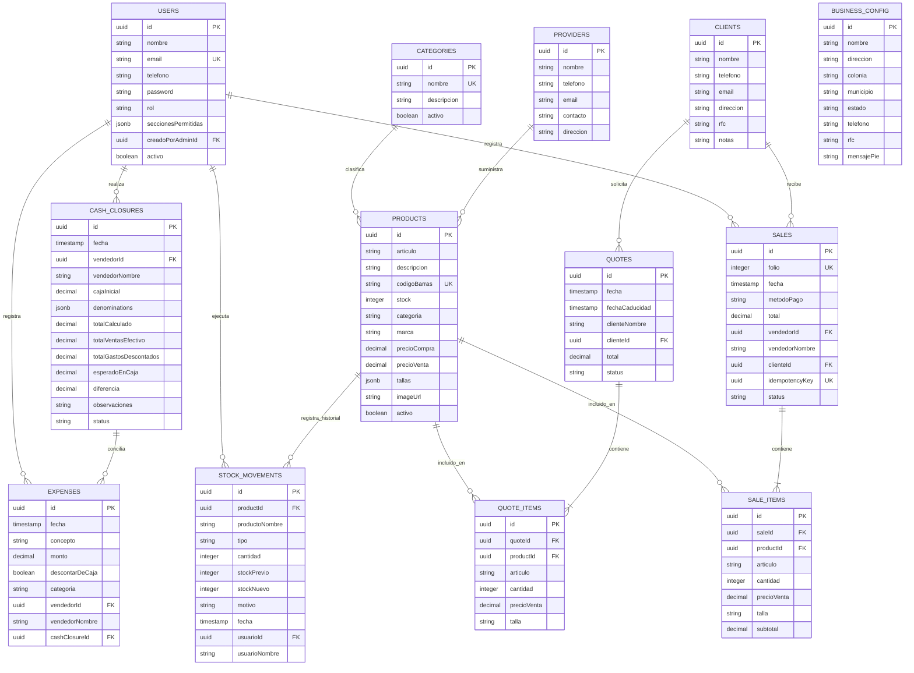

# Especificación Técnica de Servicios, Entidades y Campos: Kamadeva System Backend

**Versión:** 1.0.0  
**Fecha:** Octubre 2026  
**Sistema:** Kamadeva System (Punto de Venta e Inventario Retail Multiplataforma)  
**Stack de Referencia:** NestJS (TypeScript), PostgreSQL (Motor Transaccional ACID), Prisma / TypeORM, OpenAPI 3.0 (Swagger), JWT (Access / Refresh Tokens)  
**URL Base local:** `http://localhost:3000/api`

---

## 1. Visión General y Arquitectura de Datos

El backend de **Kamadeva System** está estructurado bajo una arquitectura modular por dominios (Domain-Driven Design / NestJS Modules), alineada estrictamente con los contratos REST consumidos por el cliente Flutter (`lib/core/network/api_client.dart` y los DataSources remotos en `lib/features/*/data/datasources/`).

### 1.1 Principios de Integridad y Transaccionalidad
1. **Consistencia ACID Estricta:** Las operaciones de venta (`/checkout/sales`), ajustes de stock (`/inventory/products/:id/adjust-stock`) y registro de movimientos de Kardex deben ejecutarse dentro de transacciones de base de datos con bloqueo pesimista o nivel de aislamiento que prevenga ventas de inventario inexistente (condición de carrera).
2. **Idempotencia Transaccional:** El endpoint de checkout requiere la cabecera/campo `idempotencyKey` (UUID v4) para evitar la duplicación de folios, cobros y deducciones de stock ante reintentos de red.
3. **Auditoría e Inmutabilidad de Caja:** Los cortes de caja cerrados no se actualizan ni se eliminan; son registros inmutables para fines de auditoría y arqueo de turnos.
4. **Control de Acceso Basado en Roles (RBAC):**
   - **`admin`**: Acceso sin restricciones a todos los recursos, configuraciones fiscales y gestión de personal.
   - **`seller`**: Acceso restringido al checkout, cotizaciones, inventario (lectura/consulta) y corte de su propio turno según su arreglo de `seccionesPermitidas`.

---

## 2. Diagrama Entidad-Relación (ERD)



---

## 3. Catálogo Detallado de Servicios, Endpoints y Campos

---

### MÓDULO 1: Autenticación y Usuarios (Auth & RBAC Service)
- **Base Endpoint:** `/api/auth`
- **Propósito:** Manejo del ciclo de vida del usuario, inicio de sesión seguro mediante JWT, verificación de rol de administrador inicial y delegación de permisos por sección.

#### Tabla / Entidad: `users`
| Campo | Tipo PostgreSQL | Restricción | Nullable | Descripción |
| :--- | :--- | :--- | :---: | :--- |
| `id` | `UUID` | PK, `gen_random_uuid()` | No | Identificador único del usuario |
| `nombre` | `VARCHAR(150)` | - | No | Nombre completo del vendedor o administrador |
| `email` | `VARCHAR(180)` | UNIQUE, INDEX | Sí | Correo electrónico de acceso |
| `telefono` | `VARCHAR(30)` | - | Sí | Teléfono móvil o de contacto del empleado |
| `password` | `VARCHAR(255)` | Hash Argon2 / Bcrypt | No | Contraseña cifrada en un solo sentido |
| `rol` | `VARCHAR(20)` | `CHECK (rol IN ('admin', 'seller'))` | No | Rol del usuario en el sistema |
| `seccionesPermitidas` | `JSONB` | Default `'[]'::jsonb` | No | Lista de slugs: `["home", "products", "categories", "clients", "providers", "quotes", "sales_history", "expenses", "cash_closure", "sellers"]` |
| `creadoPorAdminId` | `UUID` | FK -> `users(id)` | Sí | Identificador del admin que dio de alta al usuario |
| `activo` | `BOOLEAN` | Default `true` | No | Soft-delete / Desactivación de cuenta |
| `createdAt` | `TIMESTAMPTZ` | Default `NOW()` | No | Fecha de registro |
| `updatedAt` | `TIMESTAMPTZ` | Default `NOW()` | No | Última modificación |

#### Endpoints del Servicio:
* `POST /api/auth/login`
  - **Body:** `{ "email": string, "password": string }`
  - **Respuesta (200):**
    ```json
    {
      "accessToken": "eyJhbGciOi...",
      "refreshToken": "eyJhbGciOi...",
      "user": {
        "id": "uuid-001",
        "nombre": "Carlos López",
        "email": "carlos@kamadeva.com",
        "telefono": "5551112233",
        "rol": "seller",
        "seccionesPermitidas": ["home", "products", "sales_history", "cash_closure"]
      }
    }
    ```
* `POST /api/auth/register` (Requiere rol `admin` salvo durante el primer bootstrap)
  - **Body:** `{ "nombre": string, "email": string?, "telefono": string?, "password": string, "rol": "admin"|"seller", "seccionesPermitidas": string[] }`
  - **Respuesta (201):** Objeto de usuario creado (sin devolver el hash de `password`).
* `GET /api/auth/has-admin`
  - **Respuesta (200):** `{ "hasAdmin": boolean }` (Permite al frontend determinar si debe redirigir a configuración inicial).
* `GET /api/auth/:id`
  - **Respuesta (200):** DTO del usuario solicitado.
* `PUT /api/auth/:id`
  - **Body:** Campos opcionales a modificar (`nombre`, `email`, `telefono`, `password`, `seccionesPermitidas`, `rol`).
* `DELETE /api/auth/:id`
  - **Respuesta (200 / 204):** Desactivación o borrado del vendedor.

---

### MÓDULO 2: Configuración del Negocio (Business Config Service)
- **Base Endpoint:** `/api/core-config/business`
- **Propósito:** Mantiene la identidad comercial de la sucursal o matriz, impresa en la cabecera y pie de página de los tickets térmicos y facturas.

#### Tabla / Entidad: `business_config`
| Campo | Tipo PostgreSQL | Restricción | Nullable | Descripción |
| :--- | :--- | :--- | :---: | :--- |
| `id` | `UUID` | PK, `gen_random_uuid()` | No | Identificador del registro de configuración |
| `nombre` | `VARCHAR(150)` | - | No | Nombre comercial (ej. "Kamadeva Boutique & Streetwear") |
| `direccion` | `VARCHAR(255)` | - | No | Calle y número exterior/interior |
| `colonia` | `VARCHAR(100)` | - | No | Colonia o barrio |
| `municipio` | `VARCHAR(100)` | - | No | Municipio, Alcaldía o Ciudad |
| `estado` | `VARCHAR(100)` | - | No | Estado o Provincia |
| `telefono` | `VARCHAR(50)` | - | No | Teléfono de atención al cliente |
| `rfc` | `VARCHAR(20)` | - | No | Identificador fiscal (RFC / CIF / Tax ID) |
| `mensajePie` | `TEXT` | - | No | Texto de cortesía y redes sociales al final del ticket |
| `createdAt` | `TIMESTAMPTZ` | Default `NOW()` | No | Creación |
| `updatedAt` | `TIMESTAMPTZ` | Default `NOW()` | No | Modificación |

#### Endpoints del Servicio:
* `GET /api/core-config/business`
  - **Respuesta (200):**
    ```json
    {
      "nombre": "Kamadeva Boutique & Streetwear",
      "direccion": "Av. Insurgentes Sur #450 Int. 2B",
      "colonia": "Roma Sur",
      "municipio": "Cuauhtémoc",
      "estado": "Ciudad de México",
      "telefono": "55-1234-5678",
      "rfc": "KAM210315ABC",
      "mensajePie": "¡GRACIAS POR SU COMPRA! SÍGUENOS EN @KAMADEVA_MX"
    }
    ```
* `PUT /api/core-config/business` (Solo `admin`)
  - **Body:** `{ "nombre": string, "direccion": string, "colonia": string, "municipio": string, "estado": string, "telefono": string, "rfc": string, "mensajePie": string }`
  - **Respuesta (200):** Configuración actualizada.

---

### MÓDULO 3: Catálogo de Categorías (Categories Service)
- **Base Endpoint:** `/api/core-config/categories`
- **Propósito:** Agrupación y clasificación departamental de productos del catálogo.

#### Tabla / Entidad: `categories`
| Campo | Tipo PostgreSQL | Restricción | Nullable | Descripción |
| :--- | :--- | :--- | :---: | :--- |
| `id` | `UUID` | PK, `gen_random_uuid()` | No | Identificador único de categoría |
| `nombre` | `VARCHAR(100)` | UNIQUE | No | Nombre de la categoría (ej. "Playeras", "Calzado") |
| `descripcion` | `TEXT` | Default `''` | No | Detalle o notas de la categoría |
| `activo` | `BOOLEAN` | Default `true` | No | Estado de activación |
| `createdAt` | `TIMESTAMPTZ` | Default `NOW()` | No | Fecha de creación |
| `updatedAt` | `TIMESTAMPTZ` | Default `NOW()` | No | Última actualización |

#### Endpoints del Servicio:
* `GET /api/core-config/categories`
* `POST /api/core-config/categories` (`{ "nombre": string, "descripcion": string }`)
* `PUT /api/core-config/categories/:id` (`{ "nombre"?: string, "descripcion"?: string }`)
* `DELETE /api/core-config/categories/:id`

---

### MÓDULO 4: Directorio de Clientes (Clients Directory Service)
- **Base Endpoint:** `/api/core-config/clients`
- **Propósito:** Registro y fidelización de clientes para emisión de cotizaciones y facturas/tickets personalizados.

#### Tabla / Entidad: `clients`
| Campo | Tipo PostgreSQL | Restricción | Nullable | Descripción |
| :--- | :--- | :--- | :---: | :--- |
| `id` | `UUID` | PK, `gen_random_uuid()` | No | Identificador único del cliente |
| `nombre` | `VARCHAR(150)` | INDEX | No | Nombre o Razón Social |
| `telefono` | `VARCHAR(30)` | - | Sí | Teléfono de contacto |
| `email` | `VARCHAR(150)` | - | Sí | Correo electrónico |
| `direccion` | `VARCHAR(255)` | - | Sí | Dirección de envío o fiscal |
| `rfc` | `VARCHAR(20)` | - | Sí | Registro fiscal del contribuyente |
| `notas` | `TEXT` | - | Sí | Observaciones adicionales |
| `createdAt` | `TIMESTAMPTZ` | Default `NOW()` | No | Fecha de registro |
| `updatedAt` | `TIMESTAMPTZ` | Default `NOW()` | No | Última actualización |

#### Endpoints del Servicio:
* `GET /api/core-config/clients`
* `POST /api/core-config/clients` (`{ "nombre": string, "telefono"?: string, "email"?: string }`)
* `PUT /api/core-config/clients/:id`
* `DELETE /api/core-config/clients/:id`

---

### MÓDULO 5: Directorio de Proveedores (Providers Directory Service)
- **Base Endpoint:** `/api/core-config/providers`
- **Propósito:** Gestión de contactos mayoristas y fabricantes de mercancía.

#### Tabla / Entidad: `providers`
| Campo | Tipo PostgreSQL | Restricción | Nullable | Descripción |
| :--- | :--- | :--- | :---: | :--- |
| `id` | `UUID` | PK, `gen_random_uuid()` | No | Identificador único del proveedor |
| `nombre` | `VARCHAR(150)` | - | No | Razón social de la empresa proveedora |
| `telefono` | `VARCHAR(30)` | - | Sí | Teléfono comercial |
| `email` | `VARCHAR(150)` | - | Sí | Correo de cotización y pedidos |
| `contacto` | `VARCHAR(100)` | - | Sí | Nombre del agente o ejecutivo de cuenta |
| `direccion` | `VARCHAR(255)` | - | Sí | Ubicación o bodega del proveedor |
| `createdAt` | `TIMESTAMPTZ` | Default `NOW()` | No | Fecha de creación |
| `updatedAt` | `TIMESTAMPTZ` | Default `NOW()` | No | Última actualización |

#### Endpoints del Servicio:
* `GET /api/core-config/providers`
* `POST /api/core-config/providers` (`{ "nombre": string, "telefono"?: string, "email"?: string }`)
* `PUT /api/core-config/providers/:id`
* `DELETE /api/core-config/providers/:id`

---

### MÓDULO 6: Catálogo de Productos e Inventario (Products & Inventory Service)
- **Base Endpoint:** `/api/inventory/products`
- **Propósito:** Administración de existencias, control de precios, soporte de código de barras para escaneo físico, tallas y sincronización masiva Excel.

#### Tabla / Entidad: `products`
| Campo | Tipo PostgreSQL | Restricción | Nullable | Descripción |
| :--- | :--- | :--- | :---: | :--- |
| `id` | `UUID` | PK, `gen_random_uuid()` | No | Identificador único del producto |
| `articulo` | `VARCHAR(255)` | INDEX | No | Nombre descriptivo del producto comercial |
| `descripcion` | `TEXT` | Default `''` | No | Ficha técnica o detalles del artículo |
| `codigoBarras` | `VARCHAR(100)` | UNIQUE, INDEX | No | Código de barras legible por escáner de hardware/cámara |
| `stock` | `INTEGER` | `CHECK (stock >= 0)` | No | Existencia física disponible en tienda |
| `categoria` | `VARCHAR(100)` | INDEX | No | Nombre o slug de categoría |
| `marca` | `VARCHAR(100)` | - | No | Marca o fabricante de la prenda/artículo |
| `precioCompra` | `NUMERIC(12, 2)`| `CHECK (precioCompra >= 0)` | No | Costo unitario de adquisición |
| `precioVenta` | `NUMERIC(12, 2)`| `CHECK (precioVenta >= 0)` | No | Precio público para mostrador y ticket |
| `tallas` | `JSONB` | Default `'[]'::jsonb` | Sí | Lista de tallas admitidas (ej. `["CH", "M", "G", "XG"]` o `["28", "30"]`) |
| `imageUrl` | `VARCHAR(500)` | - | Sí | URL de imagen ilustrativa |
| `activo` | `BOOLEAN` | Default `true` | No | Soft-delete del producto |
| `createdAt` | `TIMESTAMPTZ` | Default `NOW()` | No | Creación |
| `updatedAt` | `TIMESTAMPTZ` | Default `NOW()` | No | Última actualización |

#### Endpoints del Servicio:
* `GET /api/inventory/products`
  - **Filtros opcionales (Query):** `?query=...&categoria=...&lowStock=true`
* `POST /api/inventory/products`
  - **Body:** `{ "articulo": string, "descripcion": string, "codigoBarras": string, "stock": int, "categoria": string, "marca": string, "precioCompra": number, "precioVenta": number, "tallas"?: string[], "imageUrl"?: string }`
* `PUT /api/inventory/products/:id`
* `DELETE /api/inventory/products/:id`
* `POST /api/inventory/products/bulk`
  - **Propósito:** Ingesta masiva desde archivos `.xlsx`.
  - **Body:** `{ "productos": [ { ... campos de producto ... } ] }`
* `POST /api/inventory/products/:id/adjust-stock`
  - **Body:**
    ```json
    {
      "tipo": "ajuste",
      "cantidad": 5,
      "motivo": "Corrección de conteo físico en anaquel",
      "usuarioNombre": "Administrador"
    }
    ```

---

### MÓDULO 7: Auditoría y Movimientos de Stock (Kardex Service)
- **Base Endpoint:** `/api/inventory/kardex`
- **Propósito:** Registro cronológico e inmutable de entradas, salidas, mermas y ventas de almacén para auditoría de inventario.

#### Tabla / Entidad: `stock_movements`
| Campo | Tipo PostgreSQL | Restricción | Nullable | Descripción |
| :--- | :--- | :--- | :---: | :--- |
| `id` | `UUID` | PK, `gen_random_uuid()` | No | Identificador del movimiento de kardex |
| `productId` | `UUID` | FK -> `products(id)`, INDEX | No | Producto afectado |
| `productoNombre` | `VARCHAR(255)` | - | No | Snapshot del nombre del artículo al momento del movimiento |
| `tipo` | `VARCHAR(20)` | `CHECK (tipo IN ('entrada', 'salida', 'ajuste', 'venta'))` | No | Clasificación del movimiento |
| `cantidad` | `INTEGER` | - | No | Número de unidades modificadas (positivo o negativo) |
| `stockPrevio` | `INTEGER` | - | No | Cantidad en existencia antes de la operación |
| `stockNuevo` | `INTEGER` | - | No | Cantidad en existencia tras la operación |
| `motivo` | `VARCHAR(255)` | - | No | Justificación del movimiento o referencia a ticket |
| `fecha` | `TIMESTAMPTZ` | Default `NOW()` | No | Momento exacto del registro |
| `usuarioId` | `UUID` | FK -> `users(id)` | Sí | Empleado responsable |
| `usuarioNombre` | `VARCHAR(150)` | - | No | Nombre del usuario que ejecutó la acción |

#### Endpoints del Servicio:
* `GET /api/inventory/kardex`
  - **Query:** `?productId=uuid&tipo=entrada&startDate=...&endDate=...`
* `POST /api/inventory/kardex`
  - Registra una entrada manual por compra a proveedor o ajuste extraordinario.

---

### MÓDULO 8: Punto de Venta y Transacciones (Sales & Checkout Service)
- **Base Endpoint:** `/api/checkout/sales`
- **Propósito:** Procesamiento central de ventas de mostrador con generación de folio correlativo único, cobro en efectivo/tarjeta y reducción atómica de existencias.

#### Tabla / Entidad: `sales`
| Campo | Tipo PostgreSQL | Restricción | Nullable | Descripción |
| :--- | :--- | :--- | :---: | :--- |
| `id` | `UUID` | PK, `gen_random_uuid()` | No | Identificador único de la venta |
| `folio` | `SERIAL / INT` | UNIQUE, INDEX | No | Folio numérico incremental de auditoría e impresión |
| `fecha` | `TIMESTAMPTZ` | Default `NOW()` | No | Fecha y hora de cobro |
| `metodoPago` | `VARCHAR(20)` | `CHECK (metodoPago IN ('CASH', 'CARD', 'TRANSFER'))` | No | Forma de pago utilizada |
| `total` | `NUMERIC(12, 2)`| `CHECK (total >= 0)` | No | Importe monetario total del ticket |
| `vendedorId` | `UUID` | FK -> `users(id)` | No | Vendedor que cobró la transacción |
| `vendedorNombre` | `VARCHAR(150)` | - | No | Nombre del vendedor para el ticket impreso |
| `clienteId` | `UUID` | FK -> `clients(id)` | Sí | Cliente asignado a la venta (opcional) |
| `idempotencyKey` | `UUID` | UNIQUE, INDEX | No | Llave única para evitar duplicidades por cortes de red |
| `status` | `VARCHAR(20)` | `CHECK (status IN ('COMPLETED', 'CANCELLED'))` | No | Estado de la venta |
| `createdAt` | `TIMESTAMPTZ` | Default `NOW()` | No | Creación |
| `updatedAt` | `TIMESTAMPTZ` | Default `NOW()` | No | Modificación |

#### Tabla / Entidad: `sale_items` (Detalle de Venta)
| Campo | Tipo PostgreSQL | Restricción | Nullable | Descripción |
| :--- | :--- | :--- | :---: | :--- |
| `id` | `UUID` | PK, `gen_random_uuid()` | No | Identificador del renglón |
| `saleId` | `UUID` | FK -> `sales(id)` ON DELETE CASCADE | No | Relación con la venta cabecera |
| `productId` | `UUID` | FK -> `products(id)` | No | Producto vendido |
| `articulo` | `VARCHAR(255)` | - | No | Snapshot del nombre del artículo |
| `cantidad` | `INTEGER` | `CHECK (cantidad > 0)` | No | Unidades vendidas |
| `precioVenta` | `NUMERIC(12, 2)`| `CHECK (precioVenta >= 0)` | No | Precio unitario al que se vendió |
| `talla` | `VARCHAR(50)` | - | Sí | Talla seleccionada (ej. 'M', '32') |
| `subtotal` | `NUMERIC(12, 2)`| - | No | `cantidad * precioVenta` |

#### Endpoints del Servicio:
* `POST /api/checkout/sales`
  - **Body:**
    ```json
    {
      "idempotencyKey": "9b1deb4d-3b7d-4bad-9bdd-2b0d7b3dcb6d",
      "metodoPago": "CASH",
      "productos": [
        {
          "productId": "prod-001",
          "cantidad": 2,
          "talla": "M"
        }
      ]
    }
    ```
  - **Proceso Interno Backend:** Inicia transacción DB -> Valida y bloquea filas de stock (`SELECT FOR UPDATE`) -> Verifica existencias -> Descuenta existencias -> Genera `stock_movements` (tipo 'venta') -> Calcula total -> Asigna siguiente `folio` -> Inserta cabecera y renglones -> Commit.
  - **Respuesta (201):**
    ```json
    {
      "id": "sale-uuid-999",
      "folio": 1042,
      "total": 598.00,
      "fecha": "2026-10-21T01:30:00Z"
    }
    ```
* `GET /api/checkout/sales`
  - **Query:** `?startDate=2026-10-01&endDate=2026-10-21&vendedorId=...`
* `GET /api/checkout/sales/:id`
  - Retorna la venta con su lista completa de `sale_items`.
* `POST /api/checkout/sales/:id/cancel`
  - Anula la venta, reingresa el stock y genera los movimientos de kardex inversos.

---

### MÓDULO 9: Cotizaciones y Presupuestos (Quotes Service)
- **Base Endpoint:** `/api/checkout/quotes`
- **Propósito:** Emisión de presupuestos a clientes con fecha de vencimiento sin descontar stock hasta su cobro formal.

#### Tabla / Entidad: `quotes`
| Campo | Tipo PostgreSQL | Restricción | Nullable | Descripción |
| :--- | :--- | :--- | :---: | :--- |
| `id` | `UUID` | PK, `gen_random_uuid()` | No | Identificador de la cotización |
| `fecha` | `TIMESTAMPTZ` | Default `NOW()` | No | Fecha de expedición |
| `fechaCaducidad` | `TIMESTAMPTZ` | - | No | Límite temporal de vigencia del precio |
| `clienteNombre` | `VARCHAR(150)` | - | No | Nombre del cliente presupuestado |
| `clienteId` | `UUID` | FK -> `clients(id)` | Sí | Cliente registrado |
| `total` | `NUMERIC(12, 2)`| - | No | Importe total presupuestado |
| `status` | `VARCHAR(30)` | Default `'PENDING'` | No | `'PENDING'`, `'EXPIRED'`, `'CONVERTED_TO_SALE'` |
| `createdAt` | `TIMESTAMPTZ` | Default `NOW()` | No | Creación |
| `updatedAt` | `TIMESTAMPTZ` | Default `NOW()` | No | Modificación |

#### Tabla / Entidad: `quote_items`
| Campo | Tipo PostgreSQL | Restricción | Nullable | Descripción |
| :--- | :--- | :--- | :---: | :--- |
| `id` | `UUID` | PK, `gen_random_uuid()` | No | Identificador del ítem cotizado |
| `quoteId` | `UUID` | FK -> `quotes(id)` ON DELETE CASCADE | No | Relación con la cotización |
| `productId` | `UUID` | FK -> `products(id)` | No | Producto de referencia |
| `articulo` | `VARCHAR(255)` | - | No | Nombre del artículo |
| `cantidad` | `INTEGER` | `CHECK (cantidad > 0)` | No | Cantidad de piezas presupuestadas |
| `precioVenta` | `NUMERIC(12, 2)`| - | No | Precio cotizado |
| `talla` | `VARCHAR(50)` | - | Sí | Talla especificada |

#### Endpoints del Servicio:
* `GET /api/checkout/quotes`
* `POST /api/checkout/quotes`
  - **Body:** `{ "fecha": string, "fechaCaducidad": string, "clienteNombre": string, "total": number, "productos": [ { "productId": string, "articulo": string, "cantidad": int, "precioVenta": number, "talla"?: string } ] }`
* `DELETE /api/checkout/quotes/:id`
* `POST /api/checkout/quotes/:id/convert-to-sale`
  - Transforma automáticamente la cotización en una venta formal deduciendo el inventario actual.

---

### MÓDULO 10: Gastos y Egresos Operativos (Expenses Service)
- **Base Endpoint:** `/api/finance/expenses`
- **Propósito:** Registro y control de salidas de efectivo por gastos de operación, compras menores, viáticos o pagos a proveedores en mostrador.

#### Tabla / Entidad: `expenses`
| Campo | Tipo PostgreSQL | Restricción | Nullable | Descripción |
| :--- | :--- | :--- | :---: | :--- |
| `id` | `UUID` | PK, `gen_random_uuid()` | No | Identificador del gasto |
| `fecha` | `TIMESTAMPTZ` | Default `NOW()` | No | Fecha y hora del egreso |
| `concepto` | `VARCHAR(255)` | - | No | Motivo de la erogación (ej. "Artículos de limpieza") |
| `monto` | `NUMERIC(12, 2)`| `CHECK (monto > 0)` | No | Importe extraído |
| `descontarDeCaja`| `BOOLEAN` | Default `false` | No | Si es `true`, impacta negativamente el dinero físico esperado en el turno |
| `categoria` | `VARCHAR(100)` | - | No | Categoría del gasto (ej. "Servicios", "Insumos", "Otros") |
| `vendedorId` | `UUID` | FK -> `users(id)` | No | Usuario que autoriza o registra el gasto |
| `vendedorNombre` | `VARCHAR(150)` | - | No | Nombre del usuario |
| `cashClosureId` | `UUID` | FK -> `cash_closures(id)` | Sí | Corte de caja al que quedó asignado este gasto |
| `createdAt` | `TIMESTAMPTZ` | Default `NOW()` | No | Creación |
| `updatedAt` | `TIMESTAMPTZ` | Default `NOW()` | No | Modificación |

#### Endpoints del Servicio:
* `GET /api/finance/expenses` (Histórico con filtros de fecha)
* `GET /api/finance/expenses/current-shift`
  - Retorna exclusivamente los gastos generados en el turno de caja abierto actual (`cashClosureId IS NULL`).
* `POST /api/finance/expenses`
  - **Body:** `{ "fecha": string, "concepto": string, "monto": number, "descontarDeCaja": boolean, "categoria": string, "vendedorId": string, "vendedorNombre": string }`
* `DELETE /api/finance/expenses/:id`

---

### MÓDULO 11: Arqueo y Cortes de Caja (Cash Closure Service)
- **Base Endpoint:** `/api/finance/cash-closures`
- **Propósito:** Conciliación matemática al terminar cada turno laboral o jornada comercial. Permite auditar diferencias (sobrantes/faltantes) mediante desglose físico de denominaciones de moneda nacional.

#### Invariante Matemática del Corte:
$$\text{Esperado en Caja} = \text{Caja Inicial} + \text{Ventas en Efectivo} - \text{Gastos Descontados de Caja}$$
$$\text{Diferencia} = \text{Total Calculado (Físico)} - \text{Esperado en Caja}$$

#### Tabla / Entidad: `cash_closures`
| Campo | Tipo PostgreSQL | Restricción | Nullable | Descripción |
| :--- | :--- | :--- | :---: | :--- |
| `id` | `UUID` | PK, `gen_random_uuid()` | No | Identificador del corte |
| `fecha` | `TIMESTAMPTZ` | Default `NOW()` | No | Fecha y hora en que se liquidó la caja |
| `vendedorId` | `UUID` | FK -> `users(id)` | No | Responsable del turno |
| `vendedorNombre` | `VARCHAR(150)` | - | No | Nombre del cajero/vendedor |
| `cajaInicial` | `NUMERIC(12, 2)`| `CHECK (cajaInicial >= 0)` | No | Fondo base con el que inició el turno |
| `denominations` | `JSONB` | - | No | Desglose por billete y moneda (ver estructura abajo) |
| `totalCalculado`| `NUMERIC(12, 2)`| - | No | Total del dinero contado físicamente |
| `totalVentasEfectivo` | `NUMERIC(12, 2)`| - | No | Ventas realizadas en efectivo en el lapso del turno |
| `totalGastosDescontados`| `NUMERIC(12, 2)`| - | No | Gastos con `descontarDeCaja = true` en el lapso |
| `esperadoEnCaja` | `NUMERIC(12, 2)`| - | No | Saldo teórico que debió existir |
| `diferencia` | `NUMERIC(12, 2)`| - | No | `totalCalculado - esperadoEnCaja` |
| `observaciones`| `TEXT` | - | Sí | Notas del cajero ante descuadres |
| `status` | `VARCHAR(20)` | Default `'CLOSED'` | No | Estado del corte (`'CLOSED'`, `'AUDITED'`) |
| `createdAt` | `TIMESTAMPTZ` | Default `NOW()` | No | Creación |
| `updatedAt` | `TIMESTAMPTZ` | Default `NOW()` | No | Modificación |

#### Estructura del JSONB de Denominaciones:
```json
{
  "1000": 2,    // 2 billetes de $1,000 = $2,000
  "500": 4,     // 4 billetes de $500   = $2,000
  "200": 5,     // 5 billetes de $200   = $1,000
  "100": 10,    // 10 billetes de $100  = $1,000
  "50": 8,      // 8 billetes de $50    = $400
  "20": 15,     // 15 billetes de $20   = $300
  "10": 20,     // 20 monedas de $10    = $200
  "5": 30,      // 30 monedas de $5     = $150
  "2": 25,      // 25 monedas de $2     = $50
  "1": 40,      // 40 monedas de $1     = $40
  "0.5": 10     // 10 monedas de $0.50  = $5
}
```

#### Endpoints del Servicio:
* `GET /api/finance/cash-closures`
  - Retorna la lista histórica ordenada descendente por fecha.
* `GET /api/finance/cash-closures/current-summary`
  - Calcula en tiempo real las ventas en efectivo del turno activo y los gastos descontados de caja para prellenar la vista del corte.
* `POST /api/finance/cash-closures`
  - **Body:**
    ```json
    {
      "fecha": "2026-10-21T01:30:00.000Z",
      "vendedorId": "seller-001",
      "vendedorNombre": "Carlos López",
      "cajaInicial": 1500.00,
      "denominations": {
        "1000": 2, "500": 4, "200": 5, "100": 10, "50": 8, "20": 15,
        "10": 20, "5": 30, "2": 25, "1": 40, "0.5": 10
      },
      "totalCalculado": 7145.00,
      "totalVentasEfectivo": 6000.00,
      "totalGastosDescontados": 355.00,
      "esperadoEnCaja": 7145.00,
      "diferencia": 0.00,
      "observaciones": "Turno cerrado sin novedades"
    }
    ```
* `GET /api/finance/cash-closures/:id`

---

### MÓDULO 12: Métricas, KPIs y Analítica (Dashboard & Analytics Service)
- **Base Endpoint:** `/api/analytics`
- **Propósito:** Agrupación y cómputo de métricas comerciales para alimentar la pantalla principal de monitoreo en tiempo real (`DashboardPage`).

#### Endpoints del Servicio:
* `GET /api/analytics/dashboard/summary`
  - **Respuesta (200):**
    ```json
    {
      "ventasHoy": {
        "montoTotal": 14250.00,
        "ticketsCount": 38,
        "efectivoTotal": 9800.00,
        "tarjetaTotal": 4450.00
      },
      "inventario": {
        "totalProductos": 342,
        "productosStockBajo": 6
      },
      "gastosHoy": {
        "total": 650.00,
        "descontadosDeCaja": 350.00
      },
      "utilidadEstimadaHoy": 5280.00
    }
    ```
* `GET /api/analytics/dashboard/top-products`
  - Lista los 5 o 10 productos con mayor volumen de unidades vendidas y mayor recaudación en el mes actual.
* `GET /api/analytics/dashboard/sales-history-chart`
  - Agrupación por días de la semana actual para despliegue de gráficas de barras/líneas.

---

## 4. Matriz de Códigos de Respuesta HTTP Estandarizados

Todos los microservicios y controladores de la API deben retornar respuestas estandarizadas bajo las siguientes condiciones:

| Código | Significado | Escenario de Uso en Kamadeva System |
| :---: | :--- | :--- |
| **`200 OK`** | Éxito en lectura o actualización | Búsqueda de productos, actualización de vendedor, consulta de caja. |
| **`201 Created`** | Creación exitosa | Venta registrada, producto dado de alta, corte liquidado. |
| **`400 Bad Request`** | Parámetros o DTO inválidos | Faltan campos obligatorios, cantidad `<= 0`, formato de JSON erróneo. |
| **`401 Unauthorized`** | No autenticado | Token JWT ausente, expirado o con firma inválida. |
| **`403 Forbidden`** | Sin autorización | Vendedor intentando cambiar la configuración del negocio o ver vendedores. |
| **`404 Not Found`** | Recurso inexistente | Producto o venta con ID no localizado. |
| **`409 Conflict`** | Conflicto de unicidad / Negocio | Código de barras duplicado, clave de idempotencia repetida, stock insuficiente. |
| **`500 Internal Error`**| Falla no controlada | Error imprevisto en la base de datos o fallo de red interno. |

---

## 5. Resumen Consolidado de Dependencias de Servicios para Despliegue

Para poner en marcha el backend completo bajo NestJS y PostgreSQL, se requieren los siguientes componentes de infraestructura y paquetes base:

1. **Gestor de Base de Datos:** PostgreSQL 15+ (con soporte nativo para extensiones `uuid-ossp` y tipos de columna `JSONB`).
2. **Validadores DTO (NestJS):**
   - `class-validator` (`@IsNotEmpty`, `@IsString`, `@IsNumber`, `@IsPositive`, `@IsUUID`, `@IsArray`, `@IsOptional`)
   - `class-transformer` (`@Type`, `@Transform`)
3. **Cifrado y Seguridad:**
   - `bcrypt` o `@node-rs/argon2` para hashing de contraseñas de usuarios.
   - `@nestjs/jwt` y `@nestjs/passport` con estrategia `passport-jwt`.
4. **Documentación Automática:**
   - `@nestjs/swagger` y `swagger-ui-express` para generar el esquema interactivo OpenAPI en `/api/docs`.
5. **Caché y Bloqueo Opcional:**
   - Redis (opcional para almacenamiento temporal de refresh tokens e idempotency keys con TTL).
